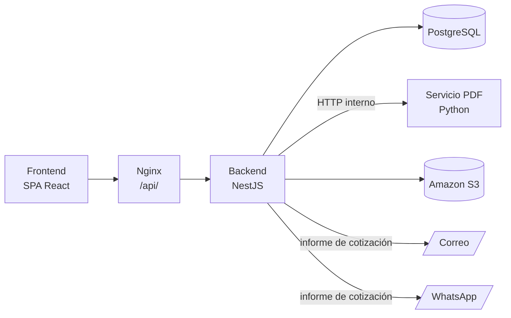
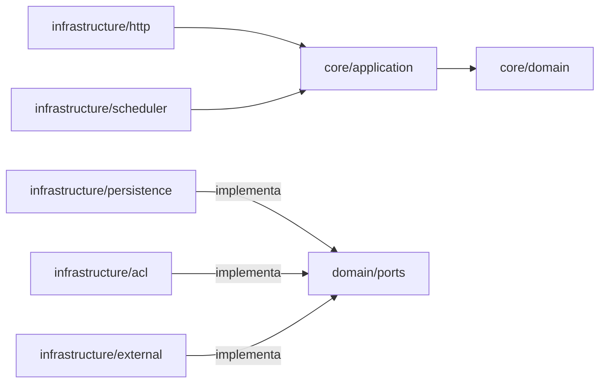
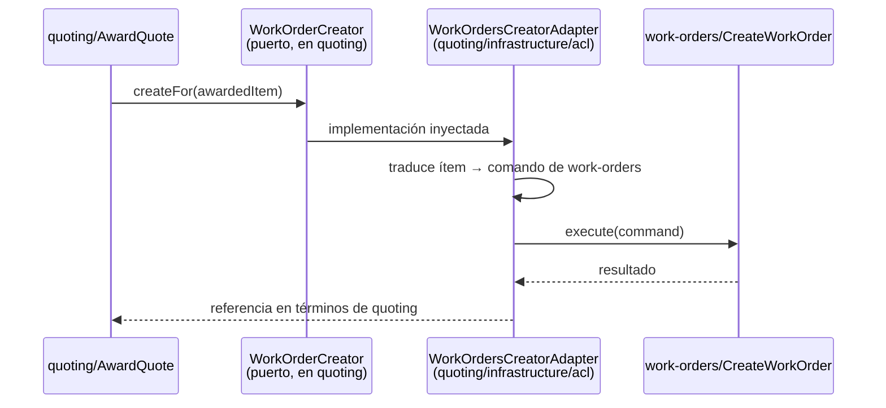
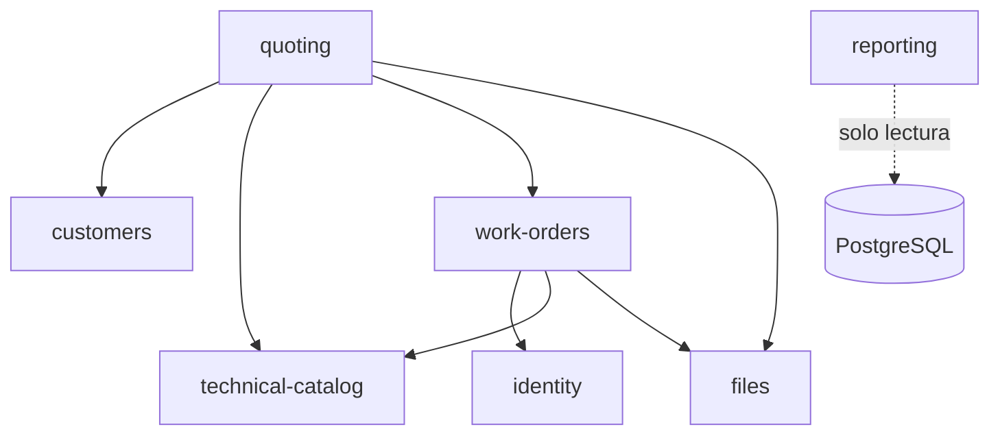

# Arquitectura del backend

Este documento es el contrato interno del equipo para el backend. Dice dónde vive cada responsabilidad y qué puede depender de qué. Complementa la [visión general de arquitectura](overview.md).

- La elección del estilo está registrada en [ADR-013](../decisiones/013-arquitectura-interna-backend.md).
- El mapa de subsistemas está en [ADR-014](../decisiones/014-subsistemas.md).
- El paso a paso para implementar una historia está en la regla [`.claude/rules/flujo-hu-backend.md`](../../.claude/rules/flujo-hu-backend.md).

**Estado:** Sprint 2 en curso. Están implementados `customers` (rubros, fábricas y encargados) y `supplier` (proveedores). El contrato del Sprint 2 (sesión, usuarios, empleados, tipos de proceso, tipo de cambio y materiales) todavía no tiene código.

Este documento describe la arquitectura **objetivo**. Lo que el código actual no cumple figura como [desvío conocido](#desvíos-conocidos-del-código-actual), no como si existiera.

---

## Contexto y alcance

El backend es una API REST hecha con NestJS ([ADR-001](../decisiones/001-backend-framework.md)). Corre como un único proceso detrás de Nginx, que le deriva las rutas `/api/`. Lo usa solo el frontend.

Depende de cinco sistemas:

| Sistema | Uso | Referencia |
| --- | --- | --- |
| PostgreSQL | Base de datos, accedida con Prisma | [ADR-002](../decisiones/002-data-base.md), [ADR-003](../decisiones/003-orm.md) |
| Servicio de PDF (Python) | Genera los PDF; se llama por HTTP interno | [ADR-004](../decisiones/004-generate-pdf.md) |
| Amazon S3 | Guarda los archivos | [ADR-009](../decisiones/009-deploy-infrastructure.md) |
| Proveedor de correo | Envía el informe de cotización | [ADR-007](../decisiones/007-mail-integration.md) |
| Proveedor de WhatsApp | Envía el informe de cotización | [ADR-008](../decisiones/008-whatsapp-integration.md) |



| Dentro del alcance | Fuera del alcance |
| --- | --- |
| Organización del código y reglas de dependencia | Modelo de datos detallado ([DER](../database/der-sprint-1-2.md)) |
| Subsistemas, sus fronteras y cómo se comunican | Endpoints, campos y mensajes ([contrato](../api-contract/API_CONTRACT_SPRINT_2.md), [OpenAPI](../openapi/openapi.yaml)) |
| Errores, transacciones, reloj, configuración y nombres | Despliegue y CI ([ADR-009](../decisiones/009-deploy-infrastructure.md), [ADR-010](../decisiones/010-continuous-integration.md)) |
| Ubicación de autenticación y autorización | Reglas de permisos por rol ([matriz RBAC](../dominio/07-matriz-rbac.md)) |

---

## Bloques y responsabilidades

### Subsistemas

El backend es un **monolito modular**. El código de negocio vive en `backend/src/subsystems/`. Hay un subsistema por funcionalidad documentada, más `files` para los archivos. La justificación y la propiedad de las tablas están en [ADR-014](../decisiones/014-subsistemas.md).

| Subsistema | Responsabilidad | Estado |
| --- | --- | --- |
| `customers` | Rubros, fábricas y encargados | Implementado |
| `technical-catalog` | Proveedores, materiales, tipos de proceso, tipo de cambio y parámetros del negocio | Proveedores implementados en `subsystems/supplier` (pendiente moverlos); el resto, contratado en el Sprint 2 |
| `identity` | Usuarios, roles, sesiones y empleados | Contratado en el Sprint 2 |
| `quoting` | Solicitudes, cotizaciones e ítems | Propuesto |
| `work-orders` | Órdenes de trabajo, ejecución, remitos y facturas | Propuesto |
| `reporting` | Reportes y consultas gerenciales, solo lectura | Propuesto |
| `files` | Archivos y su almacenamiento en S3 | Propuesto |

### Anatomía de un subsistema

Todos los subsistemas tienen la misma forma interna. Es deliberado: quien conoce uno sabe dónde buscar en los demás.

```
backend/src/subsystems/<subsistema>/
├── core/                         # No conoce NestJS, Prisma ni HTTP
│   ├── domain/
│   │   ├── entities/             # Agregados y entidades: reglas e invariantes
│   │   ├── value-objects/        # Datos que se validan al crearse (CUIT, mail…)
│   │   ├── ports/                # Clases abstractas: repositorios y necesidades externas
│   │   └── errors/               # Errores de dominio, sin códigos HTTP
│   └── application/
│       └── use-cases/            # Un caso de uso por clase, con un único execute()
└── infrastructure/               # Adaptadores: todo lo reemplazable
    ├── http/                     # Entrada: controllers, DTO, mappers de respuesta
    ├── scheduler/                # Entrada: tareas programadas
    ├── persistence/
    │   ├── prisma/               # Salida: repositorios y mappers Prisma ⇄ dominio
    │   └── in-memory/            # Fakes para los tests unitarios
    ├── acl/                      # Salida: adaptadores hacia otros subsistemas
    ├── external/                 # Salida: servicio de PDF, S3, correo, WhatsApp
    └── <subsistema>.module.ts    # Composición: qué implementación va en cada puerto
```

Cada subsistema crea solo las carpetas que necesita.

#### `core/domain/entities`: entidades

- Son clases con atributos privados y métodos que expresan **comportamiento** del negocio, no estructuras con *getters* y *setters*. Por ejemplo:
  - una cotización no tiene `setState()`, tiene `quote()`, `award()` y `markExpired()`;
  - cada método rechaza la transición si no es legal según la [máquina de estados](../dominio/06-maquinas-de-estado.md).
- El constructor es privado. Se crean con dos métodos estáticos:
  - `create(...)` para una entidad nueva: valida los invariantes.
  - `reconstruct(...)` para rehidratar desde la base.
- Lo que depende del tipo se resuelve con **polimorfismo**, no con `if` ni `switch`. Ejemplos:
  - `PlannedProcess.estimatedCost()` y `ProcessExecution.deviation()` en sus subclases (propio, tercerizado, pintado);
  - el Composite de `QuoteItem`.
- Ningún método hace entrada o salida, y ninguno lee el reloj del sistema: la fecha llega por parámetro, desde el [reloj](#reloj-y-zona-horaria).
- Ningún decorador de NestJS ni de Prisma.

#### `core/domain/value-objects`: objetos de valor

Representan un concepto que se define por su valor y tiene reglas propias.

- El molde es `Cuit` (`shared/domain/cuit.ts`): constructor privado, `create` que valida y normaliza, getters y `equals`.
- Cualquier `Cuit` que exista en memoria es válido. La validación ocurre una sola vez, al crearlo.

#### `core/domain/ports`: puertos

- **Son clases abstractas, no interfaces.** La misma clase es el tipo de TypeScript y el token de inyección de NestJS, así que no hace falta `Symbol` ni `@Inject`. Ejemplos: `SupplierRepository`, `CategoriesRepository`.
- **Hay dos tipos:**
  - repositorios del propio subsistema (`*.repository.ts`);
  - necesidades hacia afuera (`*.port.ts`).
- **Los declara el subsistema que los necesita, con su propio vocabulario.**
- **Se nombran por la necesidad del negocio, no por la tecnología.** Por ejemplo, `QuoteDocumentRenderer`, no `PdfServiceClient`.
- **Los tipos auxiliares** (parámetros, resultados) pueden vivir en el mismo archivo.

#### `core/application/use-cases`: casos de uso

- Una clase por caso de uso, con **un único método público, `execute`**. Puede tener métodos privados.
- **Coordina, no decide:**
  - pide datos a los repositorios y puertos;
  - invoca métodos de las entidades;
  - persiste;
  - devuelve el resultado.

  Si un caso de uso tiene un `if` sobre una regla del negocio, esa decisión es de una entidad.
- **Recibe un tipo de entrada propio**, que se exporta desde el mismo archivo. Nunca recibe el DTO de HTTP.
- **Lleva `@Injectable()`.** Es la única concesión al framework dentro de `core`. `core/domain` no lleva decoradores.
- **Sus dependencias son obligatorias:** nunca hay un puerto opcional (`factoryQuery?`) que permita saltear una regla.

#### `infrastructure/http`: adaptador de entrada

El controller traduce un pedido HTTP a la invocación de un caso de uso, y el resultado a una respuesta. **No contiene reglas de negocio ni llama a Prisma.**

| Pieza | Qué hace |
| --- | --- |
| DTO de entrada | Validación **sintáctica** con class-validator: tipos, formatos, obligatoriedad, largos. El `ValidationPipe` global está en `app.setup.ts` |
| Dominio | Validación **semántica**. Por ejemplo, "el rubro está inactivo" |
| Mapper de respuesta | Clase con métodos estáticos que arma el cuerpo que define el contrato |

#### `infrastructure/persistence`: adaptador de salida

- **Repositorios Prisma** que implementan los puertos.
- **Mapper Prisma ⇄ dominio:** convierte los registros en entidades con `reconstruct` y las entidades en datos para Prisma. **Ningún modelo de Prisma sale de esta carpeta.**
- **Errores de Prisma:** se traducen a errores de dominio. Por ejemplo, `P2002` (violación de unicidad) pasa a ser un `ConflictError`.
- **Repositorios en memoria:** existen solo como *fakes* para los tests unitarios.

#### `infrastructure/acl`: adaptadores anticorrupción

Implementan los puertos que apuntan a otro subsistema. Ver [comunicación entre subsistemas](#entre-subsistemas-puerto-y-adaptador-anticorrupción).

#### `<subsistema>.module.ts`: composición

Es el único lugar que dice qué implementación va en cada puerto, con `{ provide: Puerto, useClass: Implementación }`. Hace tres cosas:

1. Enlaza puertos con implementaciones.
2. Declara los controllers.
3. Exporta los casos de uso que consumen otros subsistemas, y nada más.

### Kernel compartido (`shared/`)

`shared/` sin disciplina termina siendo el lugar donde va todo lo que no se supo dónde poner. Por eso tiene una regla de admisión: **solo entra lo genuinamente transversal y sin reglas de negocio**. Un concepto de un subsistema no entra a `shared/` aunque otro subsistema lo necesite; para eso están los puertos.

| Elemento | Ubicación | Estado |
| --- | --- | --- |
| `DomainError`, `DomainValidationError` y las familias del [modelo de errores](#modelo-de-errores) | `shared/domain/errors/` | Base existente; las familias, pendientes |
| `Cuit`, `Mail`, `Phone` | `shared/domain/` | Existen |
| Paginación | `shared/domain/pagination.ts` | Existe, como función suelta (deuda) |
| Reloj (`ClockPort` y su implementación) | `shared/clock/` | Pendiente |
| Transacción (`TransactionManagerPort` y cliente de transacción) | `shared/` (dominio e infraestructura) | Pendiente |
| `AuthenticatedUser` (usuario de la sesión) | `shared/domain/` | Pendiente ([DA-04](#decisiones-pendientes)) |
| `PrismaService`, `PrismaModule` (global) | `shared/infrastructure/prisma/` | Existen |
| Filtro global de errores y *transforms* HTTP | `shared/http/` | Existen |

Fuera de `subsystems/` y `shared/` están:

- `main.ts`: arranque, CORS y apagado ordenado.
- `app.setup.ts`: pipe y filtro globales, compartidos con los tests.
- `app.module.ts`: composición raíz; solo importa módulos.
- `config/`: validación del entorno.
- `health/`: estado de la base.

---

## Relaciones e interacciones

### Reglas de dependencia



En orden de importancia:

1. **`core/domain` no importa nada de `application` ni de `infrastructure`**, ni de NestJS, Prisma, class-validator o Express.
2. **`core/application` importa solo de `core/domain`.** Depende de los puertos, nunca de sus implementaciones, y no lanza excepciones HTTP de NestJS.
3. **`infrastructure` puede importar de `core`.** Es la única dirección permitida.
4. **Ningún subsistema importa el `core` de otro.**

**Cómo se verifican:**

- ESLint (`backend/eslint.config.mjs`, regla `no-restricted-imports` por capa). Corre en la CI y falla ante una violación de los puntos 1 a 3. Tiene huecos conocidos ([DA-07](#decisiones-pendientes)).
- La revisión del *pull request*, con la pregunta "¿hay algún import de infraestructura o de otro subsistema dentro de `core`?".

### Dentro de un subsistema: directo

Las entidades y los casos de uso de un mismo subsistema se usan directamente, sin puertos.

- **Los casos de uso** pueden usar los repositorios de cualquier agregado del subsistema y los puertos que necesiten. Por ejemplo, `CreateFactory` usa `CategoriesRepository` para comprobar que el rubro esté activo.
- **Las entidades nunca usan repositorios ni puertos.** Reciben por parámetro lo que necesitan.

### Entre subsistemas: puerto y adaptador anticorrupción

La comunicación entre subsistemas es **síncrona** y tiene cuatro piezas:

1. El consumidor declara el puerto en su `core/domain/ports`, con su vocabulario.
2. Un adaptador en `infrastructure/acl/` del consumidor implementa ese puerto.
3. El adaptador invoca un **caso de uso exportado** por el módulo del proveedor. Nunca usa su repositorio ni sus entidades.
4. El adaptador traduce entre los dos vocabularios, para que el modelo de un subsistema no se filtre en el otro.



No se usan eventos de dominio. Si en el futuro un mismo hecho tiene varios efectos en otros subsistemas, se puede evaluar un mecanismo de publicación en el mismo proceso ([DA-02](#decisiones-pendientes)).

### Dependencias previstas

| Consumidor | Proveedor | Necesidad | Referencia |
| --- | --- | --- | --- |
| `quoting` | `customers` | Validar que el encargado y su fábrica existan y estén activos | CU-13, CU-14 |
| `quoting` | `technical-catalog` | Material, tipo de proceso con su precio hora vigente, proveedor, tipo de cambio, validez de la oferta y % de seña | RN13–RN22, RNF15 |
| `quoting` | `work-orders` | Crear la OT de cada ítem adjudicado | RN33, C8 ([DA-02](#decisiones-pendientes)) |
| `quoting`, `work-orders` | `files` | Registrar los archivos de solicitudes, piezas, cotizaciones y órdenes | [ADR-014](../decisiones/014-subsistemas.md#subsistema-files) |
| `work-orders` | `identity` | Validar el empleado responsable de una ejecución propia | Modelo §2.5 |
| `work-orders` | `technical-catalog` | Proveedor y tipo de proceso reales | RN40 |

`customers`, `technical-catalog`, `identity` y `files` no dependen de otros subsistemas.



### Propiedad del dato

- Hay una sola base de datos y un solo `schema.prisma`.
- Las claves foráneas entre tablas de distintos subsistemas están permitidas.
- Lo que no está permitido es que un subsistema **escriba** en una tabla ajena. La tabla que dice qué tablas escribe cada uno está en [ADR-014](../decisiones/014-subsistemas.md#propiedad-del-dato).
- El cliente de Prisma es único, así que técnicamente cualquier subsistema *podría* leer cualquier tabla. La regla se controla en la revisión de código.

### Archivos

`files` no tiene un alta genérica. El subsistema dueño de la entidad a la que pertenece el archivo hace tres pasos, en este orden:

1. Valida su entidad: que exista, que esté activa y que el usuario tenga permiso.
2. Sube el contenido a S3 por medio de `files`, **fuera** de la transacción.
3. Registra el archivo invocando, por su ACL, el caso de uso de `files`.

De esta forma, el `entity_id` polimórfico de la tabla `file` se valida en la aplicación, como exige la convención del esquema, y `files` no depende de nadie ([ADR-014](../decisiones/014-subsistemas.md#subsistema-files)).

### Tareas programadas

El vencimiento de cotizaciones (CU-22) y la detección de órdenes demoradas (CU-29) se disparan por tiempo, con `@nestjs/schedule` ([ADR-001](../decisiones/001-backend-framework.md)).

- El disparador vive en `infrastructure/scheduler/` y es un **adaptador de entrada**, igual que un controller: solo invoca casos de uso.
- Los casos de uso son **idempotentes**: ejecutarlos dos veces el mismo día no duplica efectos.
- El backend corre en una instancia EC2 siempre encendida ([ADR-009](../decisiones/009-deploy-infrastructure.md)), así que un temporizador interno es suficiente.

### Reporting: solo lectura

`reporting` es la **única excepción** a las reglas de comunicación. Cruza datos de varios subsistemas, así que no tiene dominio ni puertos: consulta la base directamente con modelos de lectura propios, con `$queryRaw` si hace falta ([ADR-003](../decisiones/003-orm.md)). Condiciones:

1. **Nunca escribe.**
2. **No impone invariantes.** Si un reporte necesita una regla, la regla vive en el subsistema dueño del dato.
3. **Sus modelos de lectura son solo de presentación** y no se reutilizan en otros subsistemas.
4. **Ningún otro subsistema puede invocar esta excepción como precedente.**

Consecuencia: `reporting` queda acoplado al esquema. Sus tests corren contra una base real para detectar cuando un cambio de columna lo rompe.

---

## Principios y restricciones

### Modelo de errores

> **Propuesta, todavía sin implementar.** El código actual tiene varios modelos de error en paralelo (ver [desvíos](#desvíos-conocidos-del-código-actual)). Este modelo se diseñó para sumarse sin romper lo que existe.

**El dominio no conoce HTTP.** Un error de dominio no sabe que existe el código 404. Así, el mismo caso de uso se puede invocar desde un controller o desde una tarea programada sin arrastrar vocabulario HTTP.

Cada error de dominio extiende `DomainError` (`shared/domain/errors/domain.error.ts`) y lleva:

| Campo | Contenido |
| --- | --- |
| `code` | Identificador estable del catálogo del [contrato, §5](../api-contract/API_CONTRACT_SPRINT_2.md) y de `components/schemas/Error.yaml`. El frontend decide qué hacer según este campo |
| `message` | Texto **en español**, listo para mostrar en el frontend |
| `details` | Opcional: `[{ field, message }]` |

Los errores se agrupan en familias. Las familias son clases abstractas de `shared/domain/errors/`; cada error concreto de un subsistema extiende una de ellas.

| Familia | HTTP | Ejemplo |
| --- | --- | --- |
| `ValidationError` | 400 | CUIT inválido. `DomainValidationError` queda como alias para no cambiar el código existente |
| `NotFoundError` | 404 | Proveedor inexistente |
| `ConflictError` | 409 | CUIT duplicado; rubro con fábricas activas |
| `ForbiddenActionError` | 403 | Acción no permitida al rol, cuando depende del recurso |
| `BusinessRuleError` | 422 | Transición de estado ilegal |
| `LockedError` | 423 | Usuario bloqueado por intentos fallidos (RNF08) |

- **Dónde se traduce a HTTP.** En un único lugar: el `AllExceptionsFilter` global (`shared/http/filters/`). Reconoce la familia y arma el cuerpo de `Error.yaml`: `{ statusCode, error, code, message, details?, path, timestamp }`.
- **Errores que no son de dominio.** Una base caída o un servicio externo que no responde son errores de infraestructura: responden 500 o 502, registran el detalle en el log y no lo exponen.

**Por qué el impacto es bajo:**

- Los filtros por controller que existen hoy tienen prioridad sobre el global y siguen funcionando.
- La migración es gradual: cuando se toca un módulo, sus errores pasan a extender una familia y se borra su filtro propio.
- Los módulos nuevos nacen con este modelo.

**Orden de los chequeos.** 401 → 400 de forma → 403 → 404 → 409/422 → 400 de contenido. Un pedido rechazado no escribe nada.

### Transacciones

Un caso de uso que escribe en varias tablas lo hace de forma atómica, pero el dominio no puede conocer la transacción de Prisma. Por eso existe el `TransactionManagerPort`:

- Vive en `shared/`, junto con el **cliente de transacción** basado en Prisma, y lo puede usar cualquier subsistema.
- El caso de uso envuelve la secuencia de escrituras en `runInTransaction(...)`.
- Los repositorios usan el cliente de la transacción activa.

Dos reglas de uso:

1. **No se llama a un servicio externo con una transacción abierta** (servicio de PDF, S3, correo, WhatsApp). Primero se confirma la transacción y después se llama al servicio.
2. **Las lecturas de validación se hacen antes de abrir la transacción.** Por ejemplo, comprobar que el cliente exista.

Las escrituras que pueden competir entre pedidos simultáneos se hacen con un `WHERE` condicional o con una restricción de la base, y el repositorio informa si escribió. Ejemplos: el número correlativo (RN04), el ID interno de pieza (RN06) y el bloqueo de inicio de sesión. Los casos concretos del Sprint 2 están en [cambios de base del Sprint 2, §7](../database/cambios-bdd-sprint2.md).

### Reloj y zona horaria

El dominio **nunca** llama a `new Date()`. Usa un `ClockPort` de `shared/clock/`, con tres operaciones: `now()`, `today()` y el fin de día. Ese módulo resuelve la zona horaria del negocio, configurada en `APP_TIMEZONE`.

- Los instantes se guardan en UTC.
- Los vencimientos se calculan en la zona del negocio. Por ejemplo, una oferta que vence "el martes" vence al final del martes local.
- En los tests, el reloj se fija. Sin esto no se puede probar el vencimiento de una cotización (RN29) ni la demora de una OT.

### Persistencia

- Hay un único `backend/prisma/schema.prisma`.
- Las tablas y columnas van en `snake_case`, con `@@map` y `@map`; los modelos, en `PascalCase`.
- **Baja lógica:** las entidades principales tienen `isActive`, y ningún repositorio hace borrado físico. **La API expone la baja con `DELETE`**, aunque sea lógica.
- Los índices únicos parciales, los CHECK, las secuencias y los triggers se escriben a mano con `make migrate-create`. Nunca se edita una migración ya aplicada ([migraciones](../database/Prisma/Migrations.md)).
- `$queryRaw` se usa solo para reportes o para SQL específico de PostgreSQL ([ADR-003](../decisiones/003-orm.md)).

### Configuración y registro de actividad

- **Validación al arranque.** Toda la configuración sale de variables de entorno y se valida al arrancar (`config/env.validation.ts`). La aplicación no arranca si falta una variable obligatoria.
- **Id de correlación.** Cada pedido debe llevar uno, y el log debe incluirlo. Está pendiente ([backlog de ingeniería, §7](../seguimiento/engineering-backlog.md#7-robustez-de-producción-antes-de-cargar-datos-reales)).
- **Datos que nunca se registran:** contraseñas, tokens ni el encabezado `Authorization`.

### Autenticación y autorización

La sesión y los permisos se rigen por [ADR-005](../decisiones/005-autentication.md), la [matriz RBAC](../dominio/07-matriz-rbac.md) y el [contrato, §4](../api-contract/API_CONTRACT_SPRINT_2.md).

Lo único que fija esta arquitectura es la regla de que **el filtrado de datos se hace en el backend, nunca solo en el frontend**. Por ejemplo, el taller (JT) no ve costos ni márgenes.

Falta definir dónde viven los guards y en qué capa se ocultan los campos ([DA-04](#decisiones-pendientes)).

### Nombres e idioma

- **El código va en inglés.** La documentación y los comentarios del código, **en español**, igual que los mensajes de error que ve el usuario.
- Los términos sin traducción limpia se conservan, y la correspondencia español→inglés debe registrarse en el glosario. Hoy no existe ([análisis SDD](../seguimiento/analisis-documentacion-sdd.md)).
- Los archivos **nuevos** siguen esta convención. Los existentes no se renombran: renombrarlos al pasar mezcla un refactor con una historia.

| Tipo | Patrón | Ejemplo |
| --- | --- | --- |
| Entidad | `<nombre>.entity.ts` | `quote.entity.ts` |
| Objeto de valor | `<nombre>.vo.ts` | `quote-number.vo.ts` |
| Puerto de repositorio | `<nombre>.repository.ts` | `quote.repository.ts` |
| Otro puerto | `<nombre>.port.ts` | `work-order-creator.port.ts` |
| Error | `<nombre>.error.ts` | `quote-not-awardable.error.ts` |
| Caso de uso | `<verbo>-<sustantivo>.use-case.ts` | `award-quote.use-case.ts` |
| DTO de entrada | `<caso-de-uso>.request.dto.ts` | `create-quote.request.dto.ts` |
| DTO o mapper de respuesta | `<nombre>.response.ts` | `quote.response.ts` |
| Repositorio Prisma | `prisma-<nombre>.repository.ts` | `prisma-quote.repository.ts` |
| Mapper Prisma | `<nombre>-prisma.mapper.ts` | `quote-prisma.mapper.ts` |
| Adaptador ACL | `<subsistema-destino>-<puerto>.adapter.ts` | `work-orders-creator.adapter.ts` |

### Programación orientada a objetos

- **El comportamiento vive en las clases del dominio.** No se agregan funciones sueltas que decidan reglas o armen respuestas.
- **Las funciones sueltas que existen hoy son deuda**, no un modelo a copiar: `isValidPage`, `isSupplierType`, `toCategoryResponse`, `toSupplierResponse`.
- **Única excepción:** los *callbacks* que exige el framework, como `bootstrap`, la función `validate` del `ConfigModule` y los *transforms* de class-transformer.

---

## Decisiones relevantes

| Decisión | ADR | Estado registrado en el ADR |
| --- | --- | --- |
| NestJS como framework | [ADR-001](../decisiones/001-backend-framework.md) | Decisión pendiente |
| PostgreSQL | [ADR-002](../decisiones/002-data-base.md) | Recomendado (pendiente de confirmación formal) |
| Prisma, con `$queryRaw` para reportes | [ADR-003](../decisiones/003-orm.md) | Decisión pendiente |
| PDF en un servicio Python síncrono | [ADR-004](../decisiones/004-generate-pdf.md) | Recomendado (pendiente de confirmación) |
| JWT y RBAC por guards | [ADR-005](../decisiones/005-autentication.md) | Decisión pendiente |
| Correo saliente | [ADR-007](../decisiones/007-mail-integration.md) | Orientación definida; proveedor pendiente |
| WhatsApp saliente | [ADR-008](../decisiones/008-whatsapp-integration.md) | Orientación definida; proveedor pendiente |
| Docker Compose en EC2 y S3 | [ADR-009](../decisiones/009-deploy-infrastructure.md) | Pendiente de aprobación |
| Integración continua | [ADR-010](../decisiones/010-continuous-integration.md) | Aceptado (implementado parcialmente) |
| Monolito modular con hexágono por subsistema | [ADR-013](../decisiones/013-arquitectura-interna-backend.md) | Propuesta |
| Subsistemas | [ADR-014](../decisiones/014-subsistemas.md) | Propuesta |

> La [visión general de arquitectura](overview.md#decisiones-de-arquitectura-adr) registra varios de estos ADR como aprobados. Ver [inconsistencias documentales](../seguimiento/inconsistencias-documentales.md#estados-de-los-adr).

### Decisiones pendientes

| ID | Tema | Qué falta decidir |
| --- | --- | --- |
| DA-01 | Frontera entre `quoting` y `work-orders` | La OT referencia ItemCotizacion, CompraDeMaterial y ProcesoPlanificado, y la Pieza se usa en ambas áreas. Falta decidir qué subsistema es dueño de cada tabla antes del Sprint 3 |
| DA-02 | Creación de la OT al adjudicar (RN33, C8) | Puerto síncrono o evento en el mismo proceso. La recomendación es síncrono, porque C8 es atómica |
| DA-03 | Convenciones transversales de la API | Nombres de filtros (`name`, `nameContains`, `search`), activos por defecto, límite de página (100 en el contrato, 1000 en `openapi.yaml`), versionado y `restore`. La baja con `DELETE` ya está decidida |
| DA-04 | Autenticación y RBAC | Dónde viven los guards, cómo se verifica la sesión en cada pedido y en qué capa se ocultan los campos que JT no ve |
| DA-05 | Configuración tipada | Los `registerAs` de `config/jwt.config.ts`, `storage.config.ts` y `database.config.ts` no se cargan. La alternativa es que cada adaptador lea y valide sus propias variables |
| DA-06 | PDF, correo, WhatsApp y registro de envíos | Si son puertos de salida de `quoting` o un subsistema `notifications`. Falta además la entidad que registra los envíos (RNF21, [modelo §4](../dominio/05-modelo-de-dominio.md#4-observaciones-para-el-diseño)) |
| DA-07 | Reforzar ESLint | Hoy no hay regla contra imports entre subsistemas, `application` puede importar excepciones HTTP de `@nestjs/common` y los imports relativos (`../../persistence/...`) evaden la regla de `http` |
| DA-08 | Objetos de valor de identificador | `CategoryId`, `FactoryId` y `ManagerId` existen, se usan a medias y lanzan `Error` genérico. Falta decidir si se adoptan o se eliminan |

---

## Atributos de calidad y límites

### Requisitos que orientan la estructura

| Requisito | Cómo lo atiende la arquitectura |
| --- | --- |
| [RNF08–RNF09](../dominio/03-requerimientos.md) (autenticación, RBAC) | Guards en la entrada HTTP; filtrado de datos en el backend |
| [RNF10](../dominio/03-requerimientos.md) (trazabilidad) | Historial de cambios como parte del dominio. Ejemplo: historial de precios de tipos de proceso |
| [RNF11](../dominio/03-requerimientos.md) (integridad, dos decimales) | `TransactionManagerPort`, restricciones en la base y cálculo de importes en el dominio |
| [RNF13](../dominio/03-requerimientos.md) (registro de errores) | Filtro global y log sin datos sensibles |
| [RNF15](../dominio/03-requerimientos.md) (parámetros configurables) | Parámetros del negocio en `technical-catalog`, sin valores fijos en el código |

### Riesgos

| ID | Riesgo | Mitigación |
| --- | --- | --- |
| R-01 | La ceremonia hexagonal (5 a 7 archivos por ABMC) frena el avance | Usar `supplier` como molde. No inventar lógica para llenar capas: los catálogos simples tienen casos de uso delgados |
| R-02 | Conviven dos estilos (`customers` y `supplier`) y un módulo nuevo copia el equivocado | Lista de desvíos (abajo) y regla del flujo HU, que fija `supplier` como molde |
| R-03 | Acoplamiento síncrono con el servicio de PDF, S3 y los proveedores de mensajería | Nunca llamarlos con una transacción abierta. Definir el comportamiento ante fallas en DA-06 |
| R-04 | Traducción del dominio al inglés: dos personas traducen el mismo concepto de forma distinta | Glosario español→inglés obligatorio (falta crearlo). Por ejemplo, hoy *encargado* aparece como `Customer` en Prisma y `Manager` en el código |
| R-05 | `reporting` queda acoplado al esquema | Tests de `reporting` contra una base real |
| R-06 | `schema.prisma` único, que crece y genera conflictos de fusión | Avisar al equipo antes de fusionar un cambio de esquema |

### Desvíos conocidos del código actual

Lo que el código implementado no cumple de esta arquitectura. **No se corrige al pasar:** se corrige cuando se toca el módulo, o en una tarea propia.

| Desvío | Dónde | Regla que incumple |
| --- | --- | --- |
| 12 casos de uso lanzan `BadRequestException`, `NotFoundException` o `ConflictException` de NestJS | `customers/core/application/use-cases/` (fábricas, encargados, `list-categories`, `deactivate-category`) | El dominio no conoce HTTP |
| Tres modelos de error: `DomainError`, `CategoryDomainError extends Error` y `Error` genérico | `customers/core/domain/errors/`, entidades `factory.ts` y `manager.ts` | Modelo de errores único |
| Filtros por módulo; dos con `@Catch()` que deducen el campo leyendo el texto del mensaje | `customers/infrastructure/http/filters/`, `supplier/infrastructure/http/filters/` | Traducción en un único filtro |
| Ningún error emite `code` | Todos los filtros | Contrato, §5 |
| Puertos opcionales que permiten saltear la regla (`factoryQuery?`, `managerQuery?`) | `DeactivateCategory`, `DeactivateFactory` | Dependencias obligatorias |
| Puertos de consulta entre agregados del mismo subsistema (`FactoryQuery`, `ManagerQuery`) | `customers` | Dentro de un subsistema, acceso directo |
| Las entidades llaman a `new Date()`; `Factory` y `Manager` tienen *setters* públicos | `customers/core/domain/entities/` | Reloj inyectado; entidades ricas |
| Mapper Prisma dentro de cada repositorio; repositorios que traducen `P2002` a excepciones HTTP | `customers/infrastructure/persistence/prisma/` | Mapper aparte; error de dominio |
| Funciones sueltas | `shared/domain/pagination.ts`, `supplier-type.ts`, mappers HTTP | Programación orientada a objetos |
| Respuestas con formas distintas: ids como texto o número, `active` frente a `isActive`, timestamps presentes o no | Fábricas y encargados frente a rubros y proveedores | Contrato |
| Baja con `PATCH …/deactivate` | Fábricas y encargados | Baja con `DELETE` ([A-04](../seguimiento/pendientes-actuales.md#a-04--p2--baja-con-delete-en-fábricas-y-encargados)) |
| Proveedores fuera de `technical-catalog`, en una carpeta en singular | `subsystems/supplier` | [ADR-014](../decisiones/014-subsistemas.md) ([A-05](../seguimiento/pendientes-actuales.md#a-05--p2--mover-supplier-a-technical-catalog)) |
| Archivos sin la convención de nombres (`category.ts`, `create-category.dto.ts`) | `customers`, `supplier` | Nombres; no se renombran |
| Sin autenticación ni guards | Todo el backend | [Contrato, §4](../api-contract/API_CONTRACT_SPRINT_2.md) |
| `TransactionManagerPort`, `ClockPort` y el id de correlación no existen todavía | `shared/` | Transacciones, reloj y registro de actividad |

---

## Documentación relacionada

- **Decisiones:** [ADR-013](../decisiones/013-arquitectura-interna-backend.md) (estilo) y [ADR-014](../decisiones/014-subsistemas.md) (subsistemas).
- **Contrato:** [contrato de la API del Sprint 2](../api-contract/API_CONTRACT_SPRINT_2.md) y [OpenAPI](../openapi/openapi.yaml).
- **Base de datos:** [DER](../database/der-sprint-1-2.md), [cambios del Sprint 2](../database/cambios-bdd-sprint2.md) y [migraciones](../database/Prisma/Migrations.md).
- **Dominio:** [reglas de negocio](../dominio/02-reglas-de-negocio.md), [casos de uso](../dominio/04-actores-y-casos-de-uso.md), [modelo](../dominio/05-modelo-de-dominio.md), [máquinas de estado](../dominio/06-maquinas-de-estado.md) y [matriz RBAC](../dominio/07-matriz-rbac.md).
- **Pruebas:** [organización](../testing/code-structure.md) y [suite de integración](../../backend/test/README.md).
- **Desarrollo:** [`backend/README.md`](../../backend/README.md) y la regla [flujo HU backend](../../.claude/rules/flujo-hu-backend.md).
- **Estado de la documentación:** [análisis SDD](../seguimiento/analisis-documentacion-sdd.md).
