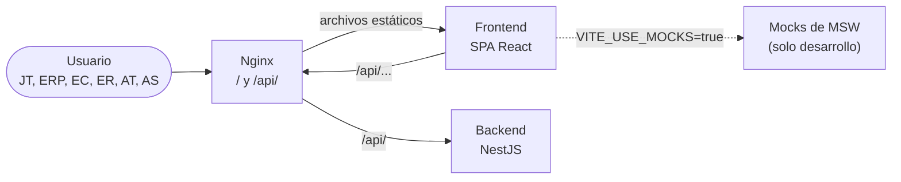

# Arquitectura del frontend

Este documento describe cómo está organizado el frontend del sistema de gestión: sus partes, cómo se relacionan entre sí y con el backend, y los criterios que lo ordenan. Complementa la [visión general de arquitectura](overview.md). Cómo se programa una feature, paso a paso, está en las guías de desarrollo de `frontend/frontend-Documents/` (ver [Documentación relacionada](#documentación-relacionada)).

Estado: Sprint 2 en curso. Las pantallas del Sprint 1 (clientes, fábricas, rubros y proveedores) están hechas; las del Sprint 2 tienen tipos, mocks y pruebas, pero todavía no pantallas.

---

## Contexto y alcance

El frontend es una **SPA React + TypeScript** de uso interno, compilada con Vite ([ADR-006](../decisiones/006-frontend-stack.md)). La usan los seis roles del sistema; cada uno ve solo los módulos que la [matriz de permisos](../conceptos-transversales/roles-y-permisos.md) le habilita.

Se comunica con un único sistema: el **backend** (NestJS), a través de su API REST. En desarrollo también puede funcionar **sin backend**, con una API simulada en el navegador (ver [Mocks de la API](#mocks-de-la-api)).

---

## Bloques y responsabilidades

El código de `frontend/src/` se divide en cuatro capas:

| Capa | Responsabilidad |
| --- | --- |
| `app/` | Composición: arranca la aplicación, define las rutas, el marco común de las pantallas (menú lateral, miga de pan) y los contextos globales (caché de datos, avisos). |
| `features/` | Un módulo por área de negocio: sesión, catálogos (clientes, fábricas, rubros, proveedores, empleados, usuarios, materiales, tipos de proceso), solicitudes, cotizaciones, piezas, órdenes de trabajo y reportes. Cada uno contiene sus pantallas, sus llamadas a la API, sus formularios y sus mocks. |
| `shared/` | Infraestructura técnica sin lógica de negocio: el cliente HTTP, el manejo de errores de la API, la paginación y los componentes visuales comunes (botones, tablas, formularios, diálogos). |
| `domain/` | Reglas de negocio que comparten varias features. Hoy, los seis roles y la matriz de permisos por módulo. |

Todas las features tienen la misma forma interna (pantallas, componentes, llamadas a la API, validaciones, tipos), así que conocer una es conocerlas todas. El detalle de carpetas y nombres está en [ESTRUCTURA.md](../../frontend/frontend-Documents/ESTRUCTURA.md).

### Navegación

El menú lateral lleva a **paneles de tarjetas** que agrupan catálogos: Clientes (encargados, fábricas y rubros) y Gestión (proveedores; en el Sprint 2 se suman materiales y tipos de proceso). El Sprint 2 agrega el panel Administración (empleados y usuarios). Los paneles, el ítem marcado del menú y la miga de pan salen de una única configuración.

---

## Relaciones e interacciones

### Con el backend

- Todas las llamadas pasan por un **único cliente HTTP** (`shared/api/http.ts`, sobre Axios). Ninguna pantalla habla con la API por su cuenta.
- El cliente llama a rutas relativas bajo `/api`. En desarrollo y en producción, **Nginx** sirve el frontend en `/` y deriva `/api/` al backend, así el navegador ve un solo origen.
- Cualquier error de la API (sin red, servidor caído, `4xx`, `5xx`) se convierte en un `ApiError` con un mensaje en español. Cada pantalla decide qué mostrar según el tipo de error, no comparando códigos a mano.
- Los datos del servidor se manejan con **TanStack Query**: caché, reintentos solo ante fallas de red o del servidor, e invalidación después de cada alta, modificación o baja. No hay un almacén global de estado ([ADR-006](../decisiones/006-frontend-stack.md)).
- Los listados grandes (encargados, proveedores) los filtra y pagina el backend. Los catálogos chicos (fábricas, rubros) se piden completos y se filtran en el navegador; como el backend acepta como máximo 100 registros por página, las listas completas se piden de a 100 hasta traer todo.

### Entre partes del frontend

- Las dependencias van en un solo sentido: `app/` usa `features/`, y `features/` usa `shared/` y `domain/`. `shared/` y `domain/` no conocen al resto.
- Una feature solo usa otra a través de lo que esa feature exporta en su punto de entrada (`index.ts`). Por ejemplo, Fábricas usa la lista de rubros que exporta Rubros, y las dos comparten la misma caché.
- Estas reglas no son solo una convención: las verifica ESLint, y el lint corre en la CI ([ADR-010](../decisiones/010-continuous-integration.md)).

### Mocks de la API

Con `VITE_USE_MOCKS=true`, y solo en desarrollo, la aplicación arranca **MSW** (Mock Service Worker): las llamadas a `/api` las responde el navegador con datos de prueba en memoria, sin backend ni base de datos. Los mocks nunca llegan al código de producción.

Los mocks copian el comportamiento real: los del Sprint 1, lo que hace hoy el backend; los del Sprint 2, el [contrato del Sprint 2](../api-contract/API_CONTRACT_SPRINT_2.md). Si el backend o el contrato cambian, se actualiza el mock. Permiten construir las pantallas del Sprint 2 antes de que exista su backend y son la base de las pruebas E2E. Detalle en [MOCKS.md](../../frontend/frontend-Documents/MOCKS.md).

### Pruebas

Las pruebas E2E están en `frontend/e2e/` y usan Playwright: un navegador real recorre la aplicación contra los mocks, buscando los elementos por su rol y su rótulo, como lo haría un usuario. Se separan por sprint y cada test se identifica con su caso de uso y su historia de Jira. Detalle en [TESTING.md](../../frontend/frontend-Documents/TESTING.md).

Esta suite prueba el frontend, no la integración con el backend real ([ADR-012](../decisiones/012-frontend-e2e-tests.md)). El backend se prueba con sus propias pruebas unitarias y de integración ([pruebas del backend](../testing/pruebas-backend.md)).

---

## Principios y restricciones

- **El contrato manda.** Endpoints, campos, reglas y códigos de error salen del [contrato de la API](../api-contract/API_CONTRACT_SPRINT_2.md); los textos de las pantallas, del [prototipo](../prototipo/fuente/CONTEXTO.md). Lo ya implementado del Sprint 1 sigue al backend.
- **Los permisos los aplica el backend.** El frontend oculta lo que un rol no puede usar (la matriz de permisos vive en `domain/roles.ts` y se consulta con `canAccess()`), pero eso es solo interfaz: el filtrado real lo hace el backend ([ADR-005](../decisiones/005-autentication.md), [visión general de arquitectura](overview.md#principios-y-restricciones)).
- **Un solo sistema de diseño.** Los componentes visuales comunes están en `shared/` y se reutilizan; las pantallas no definen botones, tablas o diálogos propios.
- **Accesibilidad.** Todo campo tiene su rótulo y todo botón de ícono, su descripción. Las pruebas dependen de eso.
- **Idioma.** El código está en inglés; las URLs, los textos de pantalla y los comentarios, en español, con el vocabulario del taller.

---

## Decisiones relevantes

| Decisión | ADR | Estado registrado |
| --- | --- | --- |
| React + TypeScript con Vite, React Router, TanStack Query, React Hook Form + Zod y Axios | [ADR-006](../decisiones/006-frontend-stack.md) | Decisión pendiente |
| Autenticación y roles (la interfaz oculta, el backend valida) | [ADR-005](../decisiones/005-autentication.md) | Decisión pendiente |
| Lint y compilación del frontend en la CI | [ADR-010](../decisiones/010-continuous-integration.md) | Aceptado (implementado parcialmente) |
| Simulación de la API con MSW para desarrollar y probar sin backend | [ADR-011](../decisiones/011-frontend-api-mocks.md) | Propuesta |
| Pruebas E2E del frontend con Playwright contra los mocks | [ADR-012](../decisiones/012-frontend-e2e-tests.md) | Propuesta |

> La [visión general de arquitectura](overview.md#decisiones-de-arquitectura-adr) registra ADR-005 y ADR-006 como aprobados. Ver [inconsistencias documentales](../seguimiento/inconsistencias-documentales.md#estados-de-los-adr).
---

## Atributos de calidad y límites

- **Tipos de la API escritos a mano.** Cada feature declara sus tipos según el contrato; la carpeta pensada para generarlos automáticamente (`src/api-contract/`) está vacía. Un cambio del contrato no produce un error de compilación.
- **Paquete sin dividir.** Toda la aplicación se descarga en un solo archivo de más de 500 kB; las rutas no se cargan de forma diferida.
- **Pruebas.** Hay pruebas E2E, pero no pruebas unitarias, y la CI todavía no corre ninguna de las dos.
- **Sesión pendiente.** Hasta que se implemente el ingreso del Sprint 2, el frontend no envía token y las pantallas del Sprint 1 no exigen sesión.

Estos puntos están registrados en [pendientes actuales](../seguimiento/pendientes-actuales.md) (H-03) y en el [backlog de ingeniería](../seguimiento/engineering-backlog.md#4-frontend).

---

## Documentación relacionada

Guías de desarrollo, junto al código:

- [frontend/README.md](../../frontend/README.md): instalación, scripts y cómo trabajar sin backend.
- [ESTRUCTURA.md](../../frontend/frontend-Documents/ESTRUCTURA.md): carpetas, reglas entre capas, nombres, roles y qué épica va en qué módulo.
- [SHARED.md](../../frontend/frontend-Documents/SHARED.md): cliente HTTP, errores, paginación y componentes comunes.
- [MOCKS.md](../../frontend/frontend-Documents/MOCKS.md): mocks de la API y usuarios de prueba.
- [TESTING.md](../../frontend/frontend-Documents/TESTING.md): pruebas E2E.

Del repositorio:

- [Visión general de arquitectura](overview.md), [configuración del entorno](../SETUP.md) y [contrato de la API](../api-contract/API_CONTRACT_SPRINT_2.md).
