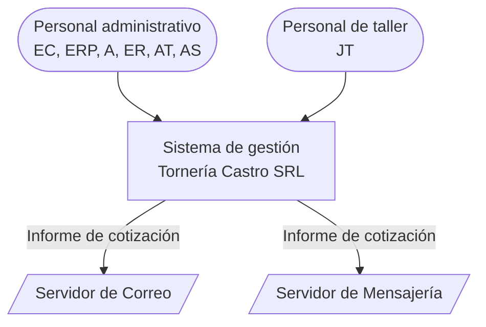

# Arquitectura del sistema — Visión general

Este documento describe la arquitectura de alto nivel del sistema de gestión de Tornería Castro SRL siguiendo el progreso por sprint. Actualmente estamos en el sprint 2. Las decisiones técnicas detalladas están en los [ADR](../decisiones/).

---

## Contexto y alcance

El sistema de gestión es una aplicación web de uso interno. Lo utilizan el personal administrativo (EC, ERP, A, ER, AT, AS) y el personal de taller (JT). Para enviar el informe de cotización al cliente se comunica con dos sistemas externos: el **Servidor de Correo (SC)** y el **Servidor de Mensajería (SM)**, definidos como actores en el [catálogo de actores](../dominio/04-actores-y-casos-de-uso.md#11-catálogo) y tratados en [ADR-007](../decisiones/007-mail-integration.md) y [ADR-008](../decisiones/008-whatsapp-integration.md).



> Los roles del diagrama se conservan como estaban documentados. El rol `A` no figura en el [catálogo de actores del dominio](../dominio/04-actores-y-casos-de-uso.md#11-catálogo); ver [inconsistencias documentales](../seguimiento/inconsistencias-documentales.md#roles-y-permisos).

---

## Bloques y responsabilidades

Vista de contenedores dentro del sistema:

```
┌─────────────────────────────────────────────────────────┐
│                   Tornería Castro SRL                    │
│                   Sistema de gestión                    │
│                                                         │
│          ┌───────────────┐                              │
│          │   Frontend    │                              │
│          │ (React SPA)   │                              │
│          └───────┬───────┘                              │
│                  │ HTTPS / REST                         │
│          ┌───────▼───────┐   HTTP interno               │
│          │   Backend    ├──────────────► Servicio PDF   │
│          │  (NestJS)    │               (Python)       │
│          └───────┬───────┘                              │
│                  │                                      │
│          ┌───────▼───────┐                              │
│          │  PostgreSQL   │                              │
│          └───────────────┘                              │
│                                                         │
│          ┌───────────────┐                              │
│          │  Amazon S3    │  ← Planos, fotos y diseños    │
│          │ (almacén de   │    3D vinculados a cada       │
│          │   objetos)    │    pieza                      │
│          └───────────────┘                              │
└─────────────────────────────────────────────────────────┘
```

### Frontend

El frontend es una **SPA React + TypeScript** compilada con Vite y servida como archivos estáticos mediante Nginx. Ver [ADR-006](../decisiones/006-frontend-stack.md) para los fundamentos completos y las bibliotecas complementarias.

La SPA se organiza en las siguientes secciones principales:

- **Solicitud de Cotizaciones** — Listado, detalle, creación y adjudicación.
- **Clientes** — CRUD de encargado, fábrica y rubros.
- **Gestión** — CRUD de proveedores, CRUD de materiales, CRUD de Tipo de Proceso.
- **Administración** — CRUD de usuarios, CRUD de empleados.

### Backend

El backend está organizado en módulos funcionales alineados con el dominio. En este sprint 2 tenemos hasta:

| Módulo | Responsabilidad |
| --- | --- |
| `identity` | Gestión de usuarios del sistema, autenticación y autorización (creación, desactivación, cambios de rol, restablecimiento de contraseñas, guards de RBAC). |
| `customers` | Subsistema conformado por las entidades/componentes Rubro, Encargados y Fábricas. |
| `employees` | Empleados. |
| `supplier` | Proveedores. |
| `technicalCatalog` | Va a contener Materiales y Tipos de Proceso. |

### Servicios de soporte

- **Servicio PDF (Python):** proceso auxiliar que genera los PDF; el backend lo invoca por HTTP interno ([ADR-004](../decisiones/004-generate-pdf.md)).
- **PostgreSQL:** datos relacionales persistentes ([ADR-002](../decisiones/002-data-base.md)).
- **Amazon S3:** almacenamiento persistente de objetos (planos, fotos, diseños 3D y PDF generados), abstraído mediante un servicio de almacenamiento para poder cambiar el proveedor sin afectar la lógica de negocio ([ADR-009](../decisiones/009-deploy-infrastructure.md)).

---

## Principios y restricciones

**Sin sobrediseño para esta escala.** Sin Redis, Kafka, Kubernetes ni Event Sourcing. El sistema es un monolito modular con un proceso Python auxiliar para PDF. Es suficiente y mantenible para el equipo y el volumen actuales (ver [ADR-009](../decisiones/009-deploy-infrastructure.md)).

**Separación de información pública y privada desde el backend.** Los endpoints que devuelven datos de cotización al frontend tienen dos variantes: una con datos completos (roles administrativos) y otra sin costos ni márgenes (JT). El filtrado nunca se realiza únicamente en el frontend. Las reglas de visibilidad se explican en [roles y permisos](../conceptos-transversales/roles-y-permisos.md).

**Despliegue.** Docker Compose en una única instancia Amazon EC2, con Nginx como proxy inverso/punto de entrada HTTPS, PostgreSQL como contenedor con almacenamiento persistente y GitHub Actions para CI/CD. CloudWatch gestiona métricas y registros de infraestructura; Sentry gestiona el seguimiento de errores de la aplicación. Ver [ADR-009](../decisiones/009-deploy-infrastructure.md) y [ADR-010](../decisiones/010-continuous-integration.md).

---

## Decisiones de arquitectura (ADR)

| Decisión | ADR | Estado |
| ------------------------- | ----------------------------------------------------- | -------------------------------- |
| Framework del backend | [ADR-001](../decisiones/001-backend-framework.md) | Aprobado |
| Base de datos | [ADR-002](../decisiones/002-data-base.md) | Aprobado |
| ORM | [ADR-003](../decisiones/003-orm.md) | Aprobado |
| Generación de PDF | [ADR-004](../decisiones/004-generate-pdf.md) | Aprobado |
| Autenticación | [ADR-005](../decisiones/005-autentication.md) | Aprobado |
| Tecnologías del frontend | [ADR-006](../decisiones/006-frontend-stack.md) | Aprobado |
| Integración de correo | [ADR-007](../decisiones/007-mail-integration.md) | Orientación arquitectónica aprobada; proveedor pendiente de presupuesto |
| Integración de WhatsApp | [ADR-008](../decisiones/008-whatsapp-integration.md) | Orientación arquitectónica aprobada; proveedor pendiente de presupuesto |
| Infraestructura de despliegue y almacenamiento de archivos | [ADR-009](../decisiones/009-deploy-infrastructure.md) | Aprobado |

> Los estados de esta tabla difieren de los registrados en los ADR: ADR-001, 003, 005 y 006 figuran como «Decisión pendiente»; ADR-002 y 004 como «Recomendado» pendiente de confirmación; ADR-009 como «Pendiente de aprobación». ADR-010 no figura en la tabla. Ver [inconsistencias documentales](../seguimiento/inconsistencias-documentales.md#estados-de-los-adr).

---

## Documentación relacionada

- [Requisitos no funcionales](../dominio/03-requerimientos.md) (RNF01–RNF21): rendimiento, seguridad, confiabilidad y portabilidad.
- [Configuración del entorno](../SETUP.md) y [migraciones](../uso-ORM-DB/Migrations.md).
- [Contrato OpenAPI](../openapi/openapi.yaml) y [referencia de API del Sprint 2](../api-contract/API_CONTRACT_SPRINT_2.md).
