# DER — Base de datos (Sprint 1 y Sprint 2)

| Campo       | Valor                                                                                 |
| ----------- | ------------------------------------------------------------------------------------- |
| Estado      | Aplicado en `schema.prisma` (20/10/2026). Migraciones pendientes                      |
| Fecha       | 19/10/2026 (actualizado 20/10/2026)                                                   |
| Fuente      | `backend/prisma/schema.prisma` y sus migraciones (Sprint 1), `API_CONTRACT_SPRINT_2.md` |
| Relacionado | [Cambios en la base de datos para el Sprint 2](cambios-bdd-sprint2.md)                |

El diagrama muestra la base **tal como quedaría** después de aplicar los cambios
de [cambios-bdd-sprint2.md](cambios-bdd-sprint2.md): las tablas del Sprint 1, con
las correcciones propuestas en su §2, y las tablas nuevas del Sprint 2.

Convenciones del diagrama:

- Los tipos son los de PostgreSQL. La longitud o la precisión va en el
  comentario de cada columna (`varchar` "100" es `VARCHAR(100)`; `numeric` "12,2"
  es `NUMERIC(12,2)`).
- `PK` clave primaria, `FK` clave foránea, `UK` única. Las unicidades que no son
  de una sola columna (compuestas, parciales o por expresión) se aclaran en el
  comentario.
- Las columnas son `NOT NULL` salvo que el comentario diga "nullable".

```mermaid
erDiagram

    %% ───────────── Sprint 1: clientes ─────────────

    category {
        int         id          PK
        varchar     name           "120, UNIQUE lower(name)"
        bool        is_active      "default true"
        timestamptz created_at
        timestamptz updated_at
    }

    factory_customer {
        int         id           PK
        varchar     name            "100, UNIQUE lower(name) WHERE is_active"
        varchar     address         "255, nullable"
        varchar     cuit            "50, UNIQUE WHERE is_active"
        varchar     pay_method      "255, nullable"
        int         category_id  FK "INDEX, antes categorie_id"
        bool        is_active       "default true"
        timestamptz created_at
        timestamptz updated_at
    }

    manager_customer {
        int         factory_id  PK, FK
        int         id          PK "correlativo por fabrica"
        varchar     name           "50"
        varchar     last_name      "50, nullable"
        varchar     phone          "50, nullable"
        varchar     mail           "255, nullable, UNIQUE (factory_id, lower(mail)) WHERE is_active"
        bool        is_active      "default true"
        timestamptz created_at
        timestamptz updated_at
    }

    quote_request {
        int         id                  PK
        int         manager_factory_id  FK
        int         manager_customer_id FK
        varchar     descp                  "200, nullable"
        date        req_date
        varchar     order_number           "50, nullable"
        bool        is_active              "default true"
        timestamptz created_at
        timestamptz updated_at
    }

    file {
        uuid               id            PK
        varchar            s3_bucket        "255"
        varchar            s3_key        UK "1024"
        varchar            original_name    "255"
        varchar            extension        "10"
        varchar            mime_type        "100"
        bigint             size_bytes       "CHECK > 0"
        document_type_enum document_type
        entity_type_enum   entity_type      "FK polimorfica, sin relacion declarada"
        int                entity_id
        timestamptz        uploaded_at
        bool               is_active        "default true"
        timestamptz        created_at
        timestamptz        updated_at
    }

    %% ───────────── Sprint 1: proveedores ─────────────

    supplier {
        int                id            PK
        supplier_type_enum supplier_type
        varchar            cuit             "50, nullable, UNIQUE WHERE is_active"
        varchar            legal_name       "80, UNIQUE lower(legal_name) WHERE is_active"
        varchar            contact_name     "150, nullable"
        varchar            address          "255, nullable"
        varchar            contact_phone    "50, nullable"
        varchar            contact_email    "255, nullable"
        varchar            observation      "255, nullable"
        bool               is_active        "default true"
        timestamptz        created_at
        timestamptz        updated_at
    }

    %% ───────────── Sprint 2: personal y acceso ─────────────

    employee {
        int                    id                 PK
        varchar                first_name            "100"
        varchar                last_name             "100"
        varchar                dni                UK "8, CHECK 7 u 8 digitos"
        employee_position_enum position
        varchar                address               "200, nullable"
        varchar                email                 "120, nullable"
        varchar                phone                 "50, nullable"
        varchar                search_key            "201, nombre y apellido normalizados (sin DNI)"
        bool                   is_active             "default true"
        int                    created_by_user_id FK "nullable"
        timestamptz            created_at
        timestamptz            updated_at
    }

    app_user {
        int         id                    PK
        int         employee_id           FK, UK "maximo un usuario por empleado"
        varchar     username              UK "30, en minusculas"
        varchar     password_hash            "255, bcrypt"
        int         failed_login_attempts    "default 0, CHECK >= 0"
        timestamptz blocked_at               "nullable"
        bool        is_active                "default true"
        int         created_by_user_id    FK "nullable"
        timestamptz created_at
        timestamptz updated_at
    }

    user_role {
        int         user_id     PK, FK
        role_enum   role        PK "JT, ERP, EC, ER, AT, AS"
        timestamptz assigned_at
    }

    user_session {
        uuid                    id               PK "claim sid del accessToken"
        int                     user_id          FK
        timestamptz             started_at
        timestamptz             last_activity_at    "sin indice"
        timestamptz             expires_at          "inicio + 7 dias"
        timestamptz             ended_at            "nullable"
        session_end_reason_enum end_reason          "nullable, MANUAL, INACTIVITY, EXPIRED, REVOKED"
    }

    refresh_token {
        uuid        id          PK
        char        token_hash  UK "64, SHA-256"
        uuid        session_id  FK
        uuid        replaced_by FK, UK "nullable, token que lo reemplazo"
        timestamptz created_at
        timestamptz revoked_at     "nullable"
    }

    %% ───────────── Sprint 2: catálogos técnicos ─────────────

    process_type {
        int         id                 PK
        varchar     name                  "100"
        varchar     name_key           UK "100, nombre normalizado"
        varchar     description           "500, nullable"
        numeric     hourly_rate_ars       "12,2, CHECK > 0"
        numeric     hourly_rate_usd       "12,2, CHECK > 0"
        numeric     exchange_rate         "12,2, CHECK > 0"
        bool        is_active             "default true"
        int         created_by_user_id FK "nullable"
        timestamptz created_at
        timestamptz updated_at
    }

    process_type_price_history {
        int         id                 PK
        int         process_type_id    FK
        timestamptz changed_at
        int         changed_by_user_id FK
        numeric     exchange_rate         "12,2, CHECK > 0"
        numeric     previous_value_usd    "12,2, CHECK > 0"
        numeric     new_value_usd         "12,2, CHECK > 0"
    }

    material {
        int         id                 PK
        varchar     name                  "60"
        varchar     quality               "60"
        varchar     name_key              "60, UNIQUE (name_key, quality_key)"
        varchar     quality_key           "60"
        bool        is_active             "default true"
        int         created_by_user_id FK "nullable"
        timestamptz created_at
        timestamptz updated_at
    }

    exchange_rate {
        smallint    id         PK "CHECK id = 1, fila unica"
        numeric     rate          "12,2, CHECK > 0"
        timestamptz quoted_at     "momento de la cotizacion"
        varchar     source        "50"
        timestamptz fetched_at
    }

    %% ───────────── Relaciones ─────────────

    category         ||--o{ factory_customer           : "rubro"
    factory_customer ||--o{ manager_customer           : "encargados"
    manager_customer ||--o{ quote_request              : "solicita"

    employee         ||--o| app_user                   : "tiene usuario"
    app_user         ||--|{ user_role                  : "roles"
    app_user         ||--o{ user_session               : "sesiones"
    user_session     ||--|{ refresh_token              : "rotacion"
    refresh_token    |o--o| refresh_token              : "replaced_by"

    process_type     ||--o{ process_type_price_history : "historial"
    app_user         ||--o{ process_type_price_history : "changed_by"

    app_user         |o--o{ employee                   : "created_by"
    app_user         |o--o{ app_user                   : "created_by"
    app_user         |o--o{ process_type               : "created_by"
    app_user         |o--o{ material                   : "created_by"
```

## Notas

- **`file` no tiene relaciones dibujadas** porque `entity_id` es una FK
  polimórfica (`entity_type` dice a qué tabla apunta) y la base no la valida.
- **`supplier`, `material` y `exchange_rate` no se relacionan todavía** con otras
  tablas de negocio: lo harán la cotización y la orden de trabajo (compra de
  material, procesos tercerizados), en sprints posteriores.
- **`user_role` es `||--|{`** (al menos un rol por usuario, RN44). La base no
  impone ese mínimo: lo garantiza el caso de uso (ver §7 de
  [cambios-bdd-sprint2.md](cambios-bdd-sprint2.md)).
- **`category.name` y `factory_customer.category_id`** aparecen con las
  correcciones del Sprint 1 (`NOT NULL`, unicidad, renombre de `categorie_id`).
  Ya están en `schema.prisma`; hasta que se apliquen las migraciones, la base
  real difiere en esos puntos.
- **Índices.** `factory_customer.category_id` tiene un índice simple, no
  parcial. `user_session` no tiene índice de sesiones abiertas: alcanza con
  `(user_id, started_at DESC)`. Detalle en el §10 de
  [cambios-bdd-sprint2.md](cambios-bdd-sprint2.md).
- **`material`:** el orden natural de la calidad ("SAE 9" antes que "SAE 10")
  lo aplica la aplicación, no la base.
