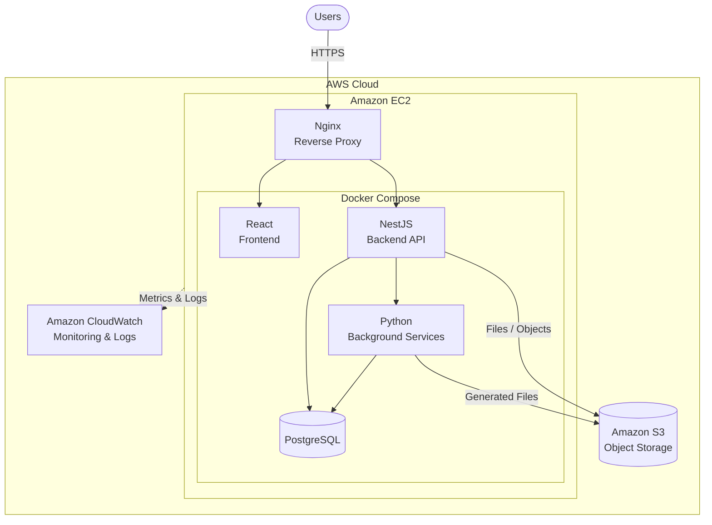
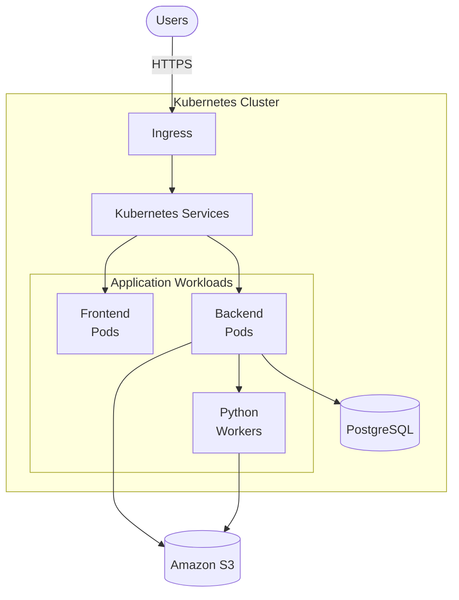
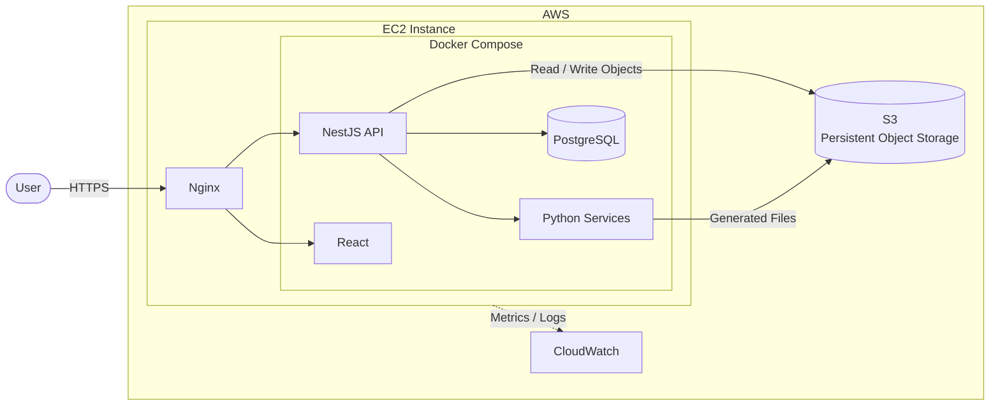
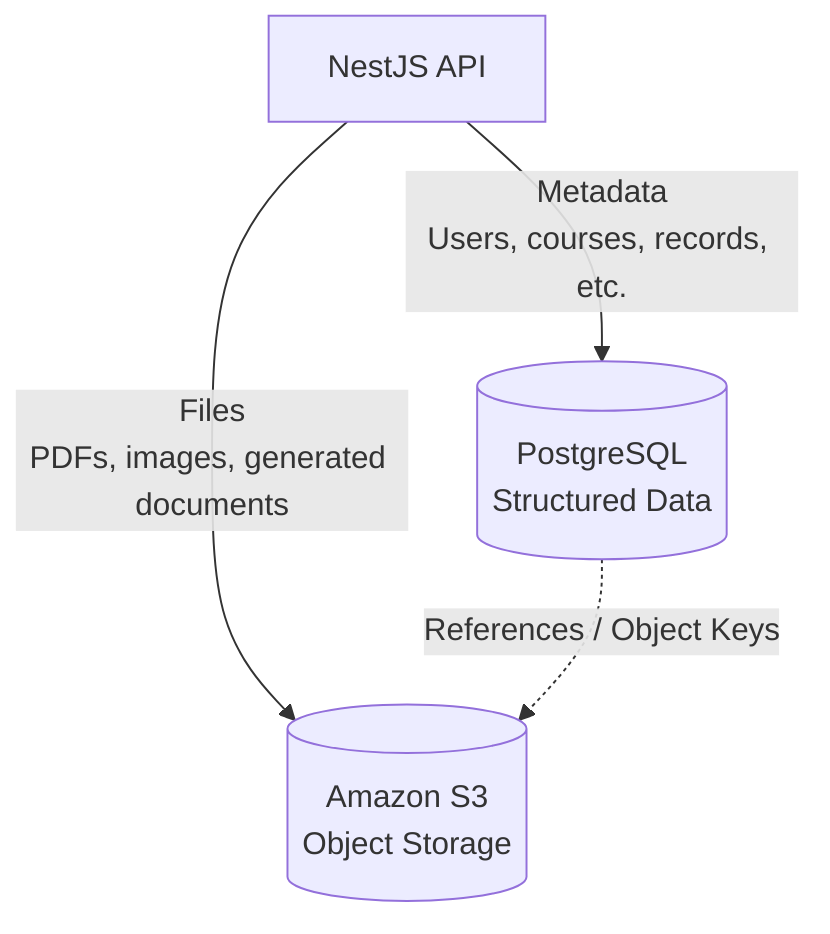

# ADR-009 — Deployment Infrastructure

**Date:** 2026-08
**Status:** Pending Aproval
**Decision-makers:** Dev-Ops Team

## Decision

We will use **Docker and Docker Compose** as the containerization and orchestration solution for the application, deployed on **AWS**.

The production environment will use **Amazon EC2** to host the application containers, **Amazon S3** for persistent object storage, and **Amazon CloudWatch** for infrastructure monitoring and centralized logging. **PostgreSQL** will run as a dedicated container within the EC2 instance using persistent storage.

This approach provides an appropriate balance between **simplicity, maintainability, portability, and resource efficiency**, while being sufficiently scalable for the expected workload and current project requirements.

Kubernetes will not be adopted at this stage because its additional operational complexity and resource requirements are not justified by the expected scale of the system.

## Context

The application requires a deployment infrastructure capable of providing consistent environments across development, testing, and production while maintaining a reasonable level of operational complexity.

The system consists of multiple services, including:

- A React frontend
- A NestJS backend API
- PostgreSQL
- Python-based background services for PDF generation and other processing tasks
- Nginx as a reverse proxy
- Persistent storage for uploaded documents, generated files, and static assets

The expected workload is relatively small, with a limited number of concurrent users. Therefore, the infrastructure should prioritize **simplicity and maintainability** over highly sophisticated orchestration and automatic horizontal scaling.

## Containerization and Orchestration Technologies

Two main approaches were evaluated: **Docker with Docker Compose** and **Kubernetes**.

### Option A — Docker + Docker Compose

Docker will be used to package each application component together with its dependencies, providing consistent and reproducible environments.

Docker Compose will be used to define and manage the multi-container application through a single configuration.

The production deployment will consist of the following services:

- **Nginx** — Reverse proxy and HTTP/HTTPS entry point
- **Frontend** — React application
- **Backend** — NestJS REST API
- **PostgreSQL** — Application database
- **Python services** — PDF generation and background processing

The resulting deployment will be conceptually structured as follows:

#### Docker Pros

- Portability across environments and cloud providers
- Consistent development, testing, and production environments
- Low operational complexity
- Simple local development using Docker Compose
- Low resource requirements
- Fast deployment and reproducible environments
- Suitable for the expected workload

#### Docker Cons

- Limited built-in orchestration capabilities
- Scaling requires additional infrastructure and configuration
- High availability must be designed separately
- Infrastructure management remains the responsibility of the team
- Monitoring and troubleshooting require additional tooling

### Option B — Kubernetes

Kubernetes provides a full container orchestration platform with features such as automatic scaling, self-healing, service discovery, rolling updates, and declarative infrastructure management.

A Kubernetes deployment could provide a more sophisticated architecture for managing multiple replicas and services:

However, Kubernetes introduces additional infrastructure and operational requirements that are not justified by the current system's expected workload.

#### Kubernetes Pros

- Advanced container orchestration
- Horizontal scaling
- Self-healing and automatic workload recovery
- Rolling updates and deployment strategies
- Service discovery and load balancing
- Suitable for large and distributed applications

#### Kubernetes Cons

- Steeper learning curve
- Higher infrastructure and resource requirements
- Greater operational complexity
- More difficult debugging and troubleshooting
- Requires additional monitoring and management
- Excessive complexity for the expected workload

## Decision Rationale

Docker Compose was selected because the application's current requirements do not justify the complexity of Kubernetes.

The expected workload is relatively small and the application consists of a limited number of services. A single EC2 instance running Docker Compose is therefore sufficient to provide the required functionality while keeping the infrastructure easy to understand, operate, and maintain.

Kubernetes may be reconsidered if future requirements introduce:

- Significant increases in traffic or concurrent users
- Multiple application instances requiring horizontal scaling
- High-availability requirements across multiple hosts
- A larger number of independently deployable services
- More sophisticated deployment strategies
- Dedicated DevOps resources

This decision intentionally favors **appropriate complexity over maximum scalability**.

## Deployment Architecture

The production infrastructure will follow the following architecture:

The responsibilities of each component are:

| Component           | Responsibility                                                       |
| ------------------- | -------------------------------------------------------------------- |
| **Nginx**           | Reverse proxy and HTTPS entry point                                  |
| **React**           | Frontend application                                                 |
| **NestJS**          | Backend API and business logic                                       |
| **PostgreSQL**      | Persistent relational data                                           |
| **Python services** | PDF generation and background processing                             |
| **S3**              | Persistent storage for documents, generated files, and static assets |
| **CloudWatch**      | Infrastructure metrics and centralized logs                          |
| **Sentry**          | Application error tracking and diagnostics                           |

## Deployment Strategy

### Implementation Plan

The deployment process will consist of the following stages:

1. **Containerization**
   Package each application component and its dependencies into Docker images.

2. **Local Orchestration**
   Use Docker Compose to run and test the complete multi-container application locally.

3. **Continuous Integration**
   Use GitHub Actions to automatically execute tests, linting, and Docker image builds when changes are pushed to the repository.

4. **Continuous Deployment**
   After successful CI validation, the deployment pipeline will update the production environment on the EC2 instance.

5. **Reverse Proxy and HTTPS**
   Nginx will act as the public entry point and reverse proxy for the application. HTTPS will be enabled using a valid TLS certificate.

6. **Monitoring and Logging**
   Amazon CloudWatch will be used for infrastructure monitoring and centralized system logs. Sentry will be used for application-level error tracking and exception monitoring.

7. **Security**
   Security measures will include:
   - HTTPS/TLS for external communication
   - IAM roles and least-privilege policies
   - EC2 Security Groups restricting unnecessary network access
   - Secrets managed outside of the Docker images and source repository
   - Regular dependency updates
   - Regular security reviews

8. **Backup and Recovery**
   PostgreSQL data will be stored on persistent storage and backed up regularly. Backup copies will be stored in S3 to provide additional durability.

   Given the relatively small expected data volume, a **weekly backup schedule** is considered sufficient for the current project requirements. This policy may be revised if the system's data volume or recovery requirements increase.

## CI/CD Architecture

The CI/CD pipeline will follow this general workflow:

```mermaid
flowchart LR
    DEV([Developer])

    GH["GitHub Repository"]
    CI["GitHub Actions"]

    TEST["Tests & Validation"]
    BUILD["Docker Image Build"]
    DEPLOY["Deployment"]

    EC2["AWS EC2"]
    COMPOSE["Docker Compose"]

    DEV -->|Push / Pull Request| GH
    GH --> CI
    CI --> TEST
    TEST -->|Success| BUILD
    BUILD --> DEPLOY
    DEPLOY --> EC2
    EC2 --> COMPOSE
```

The pipeline ensures that application changes are validated before being deployed to production.

## Data Storage Architecture

Application data will be separated according to its nature.

**PostgreSQL** will contain structured application data and metadata, while **S3** will contain binary objects such as uploaded documents and generated files.

For example, PostgreSQL may store the metadata of an uploaded document while S3 stores the actual file.

This separation prevents large binary files from unnecessarily increasing the size of the relational database.

## Operational Considerations

The selected architecture intentionally keeps the number of infrastructure components low.

The initial production environment will consist of a single EC2 instance running the application containers through Docker Compose. This provides a simple deployment model that is appropriate for the expected workload.

However, a single EC2 instance represents a potential **single point of failure**. High availability and automatic horizontal scaling are therefore not considered requirements for the initial deployment.

If these requirements emerge in the future, the architecture can be evolved toward a multi-instance deployment using additional AWS services or a container orchestration platform such as Kubernetes.

## Consequences

### Positive Consequences

- Simple deployment and infrastructure management
- Consistent environments through containerization
- Low resource consumption
- Low initial operational complexity
- Easy local reproduction of the production environment
- Clear separation between application data and object storage
- Straightforward CI/CD integration
- Architecture can evolve toward more sophisticated infrastructure if required

### Negative Consequences

- Single EC2 instance represents a potential single point of failure
- Horizontal scaling is not automatic
- Database availability depends on the EC2 instance
- Some infrastructure management remains manual
- Backup and recovery procedures must be properly maintained
- Kubernetes-level orchestration features are not available

## Alternatives Considered

| Alternative                         | Decision     | Reason                                                                   |
| ----------------------------------- | ------------ | ------------------------------------------------------------------------ |
| **Docker + Docker Compose**         | **Selected** | Appropriate complexity, low resource requirements, easy maintenance      |
| **Kubernetes**                      | Rejected     | Excessive complexity and resource requirements for the expected workload |
| **EC2 without containers**          | Rejected     | Less reproducible environments and more difficult dependency management  |
| **Managed container orchestration** | Deferred     | Could be considered if scaling or availability requirements increase     |

## Future Evolution

The architecture is intentionally designed so that individual components can be replaced or scaled independently as requirements evolve.

Potential future improvements include:

- Migration from PostgreSQL on EC2 to Amazon RDS
- Multiple EC2 instances behind a load balancer
- Managed container orchestration
- Automated horizontal scaling
- More advanced disaster recovery
- Dedicated worker infrastructure for Python services
- Infrastructure as Code using Terraform or AWS CloudFormation

These improvements are outside the scope of the current deployment requirements.
