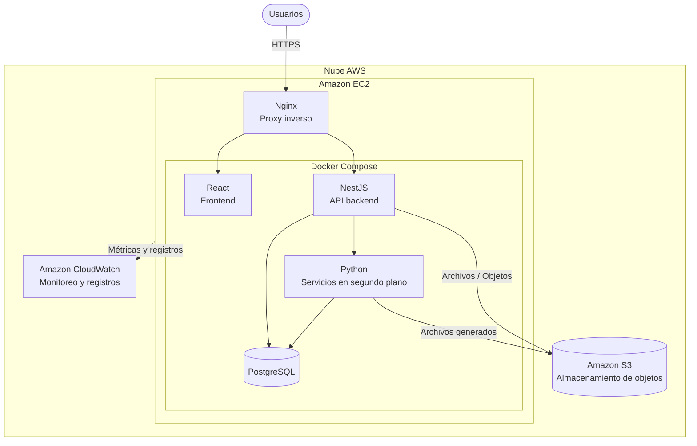
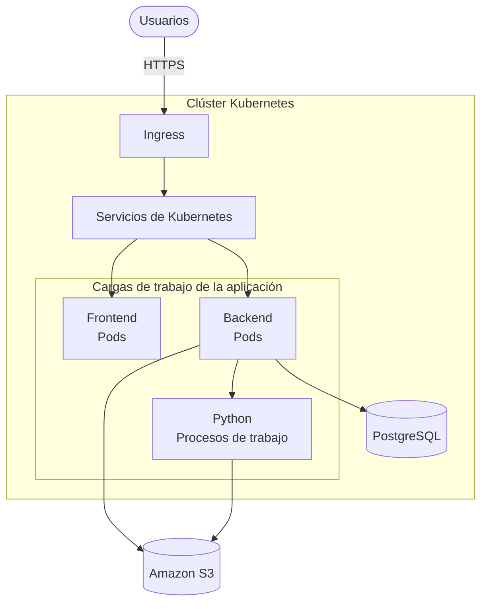
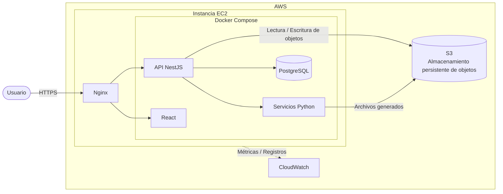
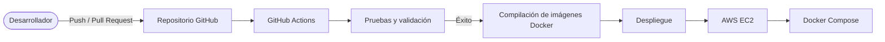
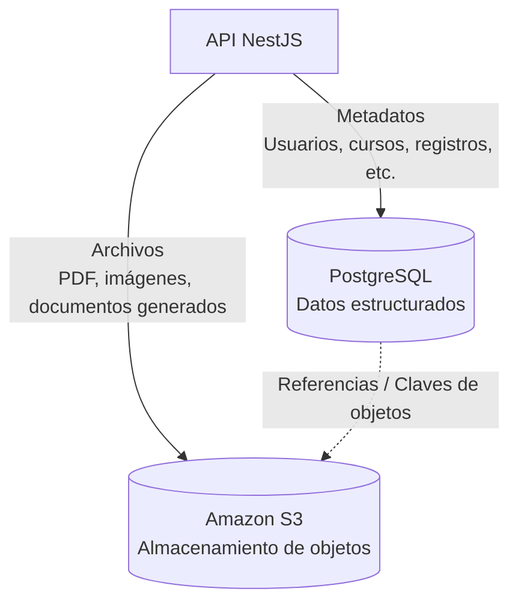

# ADR-009 — Infraestructura de despliegue

**Fecha:** 2026-08
**Estado:** Pendiente de aprobación
**Responsables de la decisión:** Equipo DevOps

## Contexto y problema

La aplicación requiere una infraestructura de despliegue capaz de ofrecer entornos consistentes en desarrollo, pruebas y producción, manteniendo un nivel razonable de complejidad operativa.

El sistema consta de varios servicios, incluidos:

- Un frontend React
- Una API backend NestJS
- PostgreSQL
- Servicios en segundo plano basados en Python para generar PDF y otras tareas de procesamiento
- Nginx como proxy inverso
- Almacenamiento persistente de documentos cargados, archivos generados y recursos estáticos

La carga esperada es relativamente pequeña, con un número limitado de usuarios concurrentes. Por lo tanto, la infraestructura debe priorizar la **simplicidad y la mantenibilidad** frente a una orquestación muy sofisticada y el escalado horizontal automático.

## Alternativas consideradas

Se evaluaron dos enfoques principales: **Docker con Docker Compose** y **Kubernetes**.

### Opción A — Docker + Docker Compose

Docker se usará para empaquetar cada componente de la aplicación con sus dependencias y proporcionar entornos consistentes y reproducibles.

Docker Compose se usará para definir y gestionar la aplicación de múltiples contenedores mediante una única configuración.

El despliegue de producción constará de los siguientes servicios:

- **Nginx** — Proxy inverso y punto de entrada HTTP/HTTPS
- **Frontend** — Aplicación React
- **Backend** — API REST NestJS
- **PostgreSQL** — Base de datos de la aplicación
- **Servicios Python** — Generación de PDF y procesamiento en segundo plano

El despliegue resultante tendrá conceptualmente la siguiente estructura:

#### Ventajas de Docker

- Portabilidad entre entornos y proveedores de nube
- Entornos consistentes de desarrollo, pruebas y producción
- Baja complejidad operativa
- Desarrollo local sencillo con Docker Compose
- Bajos requisitos de recursos
- Despliegue rápido y entornos reproducibles
- Adecuado para la carga esperada

#### Desventajas de Docker

- Capacidades integradas de orquestación limitadas
- El escalado requiere infraestructura y configuración adicionales
- La alta disponibilidad debe diseñarse por separado
- La gestión de infraestructura sigue siendo responsabilidad del equipo
- El monitoreo y la resolución de problemas requieren herramientas adicionales

### Opción B — Kubernetes

Kubernetes ofrece una plataforma completa de orquestación de contenedores con funciones como escalado automático, autorrecuperación, descubrimiento de servicios, actualizaciones graduales y gestión declarativa de infraestructura.

Un despliegue en Kubernetes podría proporcionar una arquitectura más sofisticada para gestionar múltiples réplicas y servicios:

Sin embargo, Kubernetes introduce requisitos adicionales de infraestructura y operación que no se justifican para la carga esperada del sistema actual.

#### Ventajas de Kubernetes

- Orquestación avanzada de contenedores
- Escalado horizontal
- Autorrecuperación y recuperación automática de cargas de trabajo
- Actualizaciones graduales y estrategias de despliegue
- Descubrimiento de servicios y balanceo de carga
- Adecuado para aplicaciones grandes y distribuidas

#### Desventajas de Kubernetes

- Curva de aprendizaje más pronunciada
- Mayores requisitos de infraestructura y recursos
- Mayor complejidad operativa
- Depuración y resolución de problemas más difíciles
- Requiere monitoreo y gestión adicionales
- Complejidad excesiva para la carga esperada

### Resumen de alternativas

| Alternativa | Decisión | Motivo |
| ----------------------------------- | ------------ | ------------------------------------------------------------------------ |
| **Docker + Docker Compose** | **Seleccionada** | Complejidad adecuada, bajos requisitos de recursos y mantenimiento sencillo |
| **Kubernetes** | Rechazada | Complejidad y requisitos de recursos excesivos para la carga esperada |
| **EC2 sin contenedores** | Rechazada | Entornos menos reproducibles y gestión de dependencias más difícil |
| **Orquestación administrada de contenedores** | Postergada | Podría considerarse si aumentan los requisitos de escalado o disponibilidad |

## Decisión

> Estado registrado: **Pendiente de aprobación**. Lo siguiente es la propuesta; no implica aprobación formal.

Usaremos **Docker y Docker Compose** como solución de contenedores y orquestación para la aplicación, desplegada en **AWS**.

El entorno de producción usará **Amazon EC2** para alojar los contenedores de la aplicación, **Amazon S3** para almacenamiento persistente de objetos y **Amazon CloudWatch** para monitoreo de infraestructura y registros centralizados. **PostgreSQL** se ejecutará como un contenedor dedicado dentro de la instancia EC2 con almacenamiento persistente.

Este enfoque ofrece un equilibrio adecuado entre **simplicidad, mantenibilidad, portabilidad y eficiencia de recursos**, con escalabilidad suficiente para la carga esperada y los requisitos actuales del proyecto.

No se adoptará Kubernetes en esta etapa porque su complejidad operativa adicional y sus requisitos de recursos no se justifican para la escala esperada del sistema.

### Arquitectura de despliegue

La infraestructura de producción seguirá la siguiente arquitectura:

Las responsabilidades de cada componente son:

| Componente | Responsabilidad |
| ------------------- | -------------------------------------------------------------------- |
| **Nginx** | Proxy inverso y punto de entrada HTTPS |
| **React** | Aplicación frontend |
| **NestJS** | API backend y lógica de negocio |
| **PostgreSQL** | Datos relacionales persistentes |
| **Servicios Python** | Generación de PDF y procesamiento en segundo plano |
| **S3** | Almacenamiento persistente de documentos, archivos generados y recursos estáticos |
| **CloudWatch** | Métricas de infraestructura y registros centralizados |
| **Sentry** | Seguimiento de errores y diagnóstico de la aplicación |

### Estrategia de despliegue

#### Plan de implementación

El proceso de despliegue constará de las siguientes etapas:

1. **Creación de contenedores**
   Empaquetar cada componente de la aplicación y sus dependencias en imágenes Docker.

2. **Orquestación local**
   Usar Docker Compose para ejecutar y probar localmente la aplicación completa de múltiples contenedores.

3. **Integración continua**
   Usar GitHub Actions para ejecutar automáticamente pruebas, análisis estático y compilaciones de imágenes Docker cuando se envíen cambios al repositorio.

4. **Despliegue continuo**
   Después de una validación de CI exitosa, el proceso de despliegue actualizará el entorno de producción en la instancia EC2.

5. **Proxy inverso y HTTPS**
   Nginx actuará como punto de entrada público y proxy inverso de la aplicación. Se habilitará HTTPS con un certificado TLS válido.

6. **Monitoreo y registros**
   Amazon CloudWatch se usará para monitoreo de infraestructura y registros centralizados del sistema. Sentry se usará para seguimiento de errores de la aplicación y monitoreo de excepciones.

7. **Seguridad**
   Las medidas de seguridad incluirán:
   - HTTPS/TLS para comunicación externa
   - Roles IAM y políticas de mínimo privilegio
   - Grupos de seguridad EC2 que restrinjan el acceso de red innecesario
   - Secretos gestionados fuera de las imágenes Docker y del repositorio de código
   - Actualizaciones periódicas de dependencias
   - Revisiones periódicas de seguridad

8. **Respaldo y recuperación**
   Los datos de PostgreSQL se guardarán en almacenamiento persistente y se respaldarán periódicamente. Las copias de respaldo se almacenarán en S3 para ofrecer durabilidad adicional.

   Dado el volumen de datos esperado relativamente pequeño, se considera suficiente una **frecuencia semanal de respaldos** para los requisitos actuales del proyecto. Esta política puede revisarse si aumentan el volumen de datos o los requisitos de recuperación del sistema.

   > Esta frecuencia difiere de [RNF14](../domain/03-requerimientos.md#rnf14--confiabilidad--backups-y-recuperación) (respaldo diario, ≥ 15 copias); ver [inconsistencias documentales](../seguimiento/inconsistencias-documentales.md#requisitos-y-adr).

### Arquitectura de CI/CD

El proceso de CI/CD seguirá este flujo general:

El proceso asegura que los cambios de la aplicación se validen antes de desplegarse en producción.

### Arquitectura de almacenamiento de datos

Los datos de la aplicación se separarán según su naturaleza.

**PostgreSQL** contendrá datos estructurados y metadatos de la aplicación, mientras que **S3** contendrá objetos binarios como documentos cargados y archivos generados.

Por ejemplo, PostgreSQL puede almacenar los metadatos de un documento cargado mientras S3 almacena el archivo en sí.

Esta separación evita que los archivos binarios grandes aumenten innecesariamente el tamaño de la base de datos relacional.

## Fundamentos de la decisión

Se seleccionó Docker Compose porque los requisitos actuales de la aplicación no justifican la complejidad de Kubernetes.

La carga esperada es relativamente pequeña y la aplicación consta de un número limitado de servicios. Por lo tanto, una única instancia EC2 con Docker Compose es suficiente para ofrecer la funcionalidad requerida y mantener una infraestructura fácil de comprender, operar y mantener.

Kubernetes puede reconsiderarse si los requisitos futuros introducen:

- Aumentos significativos del tráfico o de los usuarios concurrentes
- Múltiples instancias de la aplicación que requieran escalado horizontal
- Requisitos de alta disponibilidad entre varios servidores
- Un mayor número de servicios desplegables de manera independiente
- Estrategias de despliegue más sofisticadas
- Recursos DevOps dedicados

Esta decisión favorece deliberadamente la **complejidad adecuada frente a la máxima escalabilidad**.

## Consecuencias

### Consecuencias positivas

- Despliegue y gestión de infraestructura sencillos
- Entornos consistentes mediante contenedores
- Bajo consumo de recursos
- Baja complejidad operativa inicial
- Reproducción local sencilla del entorno de producción
- Separación clara entre datos de la aplicación y almacenamiento de objetos
- Integración directa de CI/CD
- La arquitectura puede evolucionar hacia una infraestructura más sofisticada si se requiere

### Consecuencias negativas

- Una única instancia EC2 representa un posible punto único de falla
- El escalado horizontal no es automático
- La disponibilidad de la base de datos depende de la instancia EC2
- Parte de la gestión de infraestructura sigue siendo manual
- Los procedimientos de respaldo y recuperación deben mantenerse adecuadamente
- No están disponibles las funciones de orquestación del nivel de Kubernetes

### Consideraciones operativas

La arquitectura seleccionada mantiene deliberadamente bajo el número de componentes de infraestructura.

El entorno inicial de producción constará de una única instancia EC2 que ejecutará los contenedores de la aplicación mediante Docker Compose. Esto ofrece un modelo de despliegue sencillo, adecuado para la carga esperada.

Sin embargo, una única instancia EC2 representa un posible **punto único de falla**. Por lo tanto, la alta disponibilidad y el escalado horizontal automático no se consideran requisitos del despliegue inicial.

Si estos requisitos aparecen en el futuro, la arquitectura puede evolucionar hacia un despliegue de múltiples instancias mediante servicios adicionales de AWS o una plataforma de orquestación de contenedores como Kubernetes.

## Evolución futura

La arquitectura está diseñada deliberadamente para que los componentes individuales puedan reemplazarse o escalarse de manera independiente a medida que evolucionen los requisitos.

Las posibles mejoras futuras incluyen:

- Migración de PostgreSQL en EC2 a Amazon RDS
- Múltiples instancias EC2 detrás de un balanceador de carga
- Orquestación administrada de contenedores
- Escalado horizontal automatizado
- Recuperación ante desastres más avanzada
- Infraestructura de procesos de trabajo dedicada para servicios Python
- Infraestructura como código con Terraform o AWS CloudFormation

Estas mejoras quedan fuera del alcance de los requisitos actuales de despliegue.
