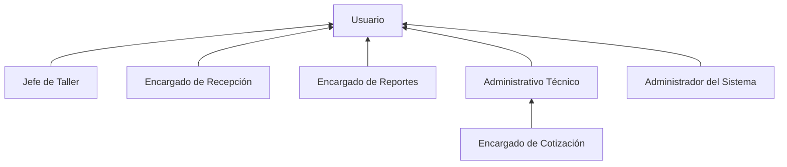
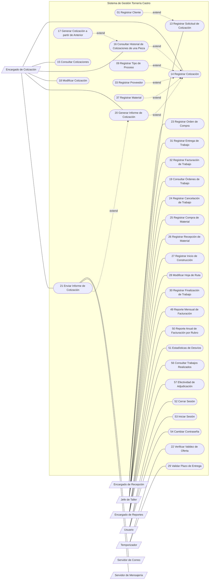
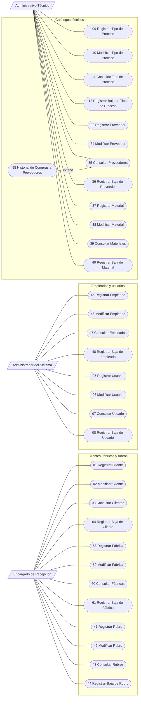

# 04 · Actores y casos de uso

> Fuente: Casos de Uso V1.1 (§1.1–1.5) y diagramas oficiales `Casos de Uso Esenciales V1.1.png` / `Casos de Uso de Soporte V1.1.png`.

---

## 1. Actores

### 1.1 Catálogo

| Sigla | Actor | Tipo | Rol frente al sistema | Hereda de |
|---|---|---|---|---|
| US | **Usuario** | Persona (abstracto) | Cualquier persona autorizada. Se autentica, cambia su contraseña y cierra sesión. | — |
| JT | **Jefe de Taller** | Persona | Encargado de producción: coordina y supervisa la ejecución de las OT en el taller, el avance de la producción y el abastecimiento de materiales. | US |
| ERP | **Encargado de Recepción** | Persona | Contacto inicial con el cliente y gestión administrativa de la recepción y entrega de trabajos (solicitudes, OC, remitos, facturas). Mantiene clientes, fábricas y rubros. | US |
| ER | **Encargado de Reportes** | Persona | Obtiene información estadística y gerencial para el seguimiento de la empresa y la toma de decisiones. | US |
| AT | **Administrativo Técnico** | Persona | Mantiene la información técnica usada para planificar y ejecutar trabajos: catálogos de materiales, tipos de proceso y proveedores. | US |
| EC | **Encargado de Cotización** | Persona | Elabora y administra las cotizaciones: evalúa trabajos anteriores, calcula presupuestos y genera la documentación. **Hereda del AT**, por lo que durante una cotización puede dar de alta materiales, proveedores y tipos de proceso. | AT (→ US) |
| AS | **Administrador del Sistema** | Persona | Administra el sistema y la seguridad de acceso: empleados, cuentas de usuario y asignación de roles. | US |
| SC | **Servidor de Correo** | Sistema externo | Envía correos electrónicos (SMTP, RNF19). Actor secundario. | — |
| SM | **Servidor de Mensajería** | Sistema externo | Mensajería instantánea: API oficial de WhatsApp Business (RNF20). Actor secundario. | — |
| T | **Temporizador** | Tiempo | Dispara los casos de uso automáticos (procesos programados). | — |

### 1.2 Jerarquía de actores

> Los roles del sistema (RN44) son exactamente JT, ERP, ER, EC, AT y AS. Un usuario puede tener varios.

---

## 2. Catálogo de casos de uso

**Categoría:** E = esencial · S = soporte (según el diagrama oficial en el que aparece). **Tipo:** todos concretos.

### 2.1 Clientes, fábricas y rubros — RF01, RF07

| CU | Nombre | Objetivo | AP | AS | Cat. |
|---|---|---|---|---|---|
| CU-01 | Registrar Cliente | Dar de alta un encargado cliente (nombre, apellido, teléfono, mail) asociado a su fábrica. | ERP | — | S (extiende CU-13) |
| CU-02 | Modificar Cliente | Actualizar los datos de un encargado cliente. | ERP | — | S |
| CU-03 | Consultar Cliente | Visualizar los encargados clientes registrados. | ERP | — | S |
| CU-04 | Registrar Baja de Cliente | Baja lógica de un encargado cliente. | ERP | — | S |
| CU-41 | Registrar Rubro | Registrar un nuevo rubro. | ERP | — | S |
| CU-42 | Modificar Rubro | Actualizar un rubro. | ERP | — | S |
| CU-43 | Consultar Rubro | Consultar los rubros registrados. | ERP | — | S |
| CU-44 | Registrar Baja de Rubro | Baja lógica de un rubro. | ERP | — | S |
| CU-58 | Registrar Fábrica | Registrar una fábrica cliente: nombre, dirección, CUIT, formas de pago y rubro. | ERP | — | S |
| CU-59 | Modificar Fábrica | Actualizar los datos de una fábrica. | ERP | — | S |
| CU-60 | Consultar Fábricas | Visualizar las fábricas registradas. | ERP | — | S |
| CU-61 | Registrar Baja de Fábrica | Baja lógica de una fábrica. | ERP | — | S |

### 2.2 Usuarios, empleados y sesión — RF02, RF04

| CU | Nombre | Objetivo | AP | AS | Cat. |
|---|---|---|---|---|---|
| CU-05 | Registrar Usuario | Crear el usuario de un empleado ya registrado, con nombre e id únicos y contraseña, asignándole uno o varios roles. | AS | — | S |
| CU-06 | Modificar Usuario | Actualizar los datos o roles de un usuario, incluido el restablecimiento de su contraseña. | AS | — | S |
| CU-07 | Consultar Usuario | Visualizar los usuarios y sus roles. | AS | — | S |
| CU-08 | Registrar Baja de Usuario | Baja lógica de un usuario. | AS | — | S |
| CU-45 | Registrar Empleado | Registrar nombre y apellido de un empleado, tenga o no usuario. | AS | — | S |
| CU-46 | Modificar Empleado | Actualizar los datos de un empleado. | AS | — | S |
| CU-47 | Consultar Empleados | Consultar los empleados registrados. | AS | — | S |
| CU-48 | Registrar Baja de Empleado | Baja lógica de un empleado; **si tiene usuario, se desactiva automáticamente** (RN44). | AS | — | S |
| CU-52 | Cerrar Sesión | Cerrar la sesión actual. | US | — | E |
| CU-53 | Iniciar Sesión | Iniciar sesión con nombre de usuario y contraseña. | US | — | E |
| CU-54 | Cambiar Contraseña | Cambiar la contraseña propia ingresando la actual y la nueva. | US | — | E |

### 2.3 Catálogos técnicos — RF03, RF05, RF06

| CU | Nombre | Objetivo | AP | AS | Cat. |
|---|---|---|---|---|---|
| CU-09 | Registrar Tipo de Proceso | Alta de una categoría de proceso con su costo por hora base en pesos y dólares. | AT | — | S (extiende CU-14) |
| CU-10 | Modificar Tipo de Proceso | Actualizar un tipo de proceso, incluida la variación de su precio hora en el tiempo. | AT | — | S |
| CU-11 | Consultar Tipo de Proceso | Visualizar los tipos de proceso. | AT | — | S |
| CU-12 | Registrar Baja de Tipo de Proceso | Baja lógica de un tipo de proceso. | AT | — | S |
| CU-33 | Registrar Proveedor | Alta de un proveedor de materiales, servicios tercerizados, repuestos o pintura. | AT | — | S (extiende CU-14) |
| CU-34 | Modificar Proveedor | Actualizar un proveedor. | AT | — | S |
| CU-35 | Consultar Proveedor | Visualizar los proveedores. | AT | — | S |
| CU-36 | Registrar Baja de Proveedor | Baja lógica de un proveedor. | AT | — | S |
| CU-37 | Registrar Material | Registrar un nuevo material para usar en cotizaciones. | AT | — | S (extiende CU-14) |
| CU-38 | Modificar Material | Actualizar un material. | AT | — | S |
| CU-39 | Consultar Materiales | Consultar los materiales. | AT | — | S |
| CU-40 | Registrar Baja de Material | Baja lógica de un material. | AT | — | S |
| CU-55 | Consultar Historial de Compras a Proveedores | Consultar las compras de material a proveedores (material, calidad, presentación, cantidad, precio unitario, fecha), filtrando por proveedor, material y fechas. | EC | — | S (extiende CU-35) |

### 2.4 Cotización — RF08, RF09

| CU | Nombre | Objetivo | AP | AS | Cat. |
|---|---|---|---|---|---|
| CU-13 | Registrar Solicitud de Cotización | Registrar una solicitud recibida por mail o WhatsApp con fecha, descripción, cliente, PDF y planos o fotos de pieza patrón, y derivarla a un EC. **Crea la cotización en `PteCotizacion`.** | ERP | — | E |
| CU-14 | Registrar Cotización | Cargar datos generales (validez, fecha, moneda) y cotizar cada ítem en secuencia (material, procesos propios y tercerizados, repuestos, tratamientos), calculando precio unitario y total. | EC | — | E |
| CU-15 | Consultar Cotizaciones | Visualizar las cotizaciones filtrando por cliente, fábrica, nº de plano, estado, responsable, descripción y fechas. | EC | — | E |
| CU-16 | Consultar Historial de Cotizaciones de una Pieza | Ver, por nº de plano, las cotizaciones anteriores de una pieza: fecha, adjudicación, dólar del momento, desvío, observaciones, con acceso a la hoja de ruta y al detalle. | EC | — | E (extiende CU-14) |
| CU-17 | Generar Cotización a partir de Cotización Anterior | Cotizar una pieza ya cotizada partiendo de una cotización anterior, con procesos y costos precargados y modificables. | EC | — | E (extiende CU-16) |
| CU-18 | Modificar Cotización | Modificar una cotización en `Borrador` o `Cotizado` `🔁 D-04`: descuentos y señas, datos generales, piezas, materiales, procesos, proveedores y cantidades. Todo queda en el historial. | EC | — | E |
| CU-20 | Generar Informe de Cotización | Generar el PDF con el formato de Tornería Castro: plazo de validez y, por pieza, descripción, cantidad, precio unitario, precio total, plazo de entrega y condición de pago. | EC | — | E (extiende CU-14) |
| CU-21 | Enviar Informe de Cotización | Enviar el informe al cliente por mail o WhatsApp. | EC | SC, SM | E (extiende CU-20) |
| CU-22 | Verificar Validez de Oferta de Cotización | Diariamente, pasar a `Vencido` las cotizaciones `Cotizado` cuyo plazo de validez venció (habitualmente 7 días). | T | — | E |

### 2.5 Trabajos adjudicados — RF10

| CU | Nombre | Objetivo | AP | AS | Cat. |
|---|---|---|---|---|---|
| CU-19 | Consultar Órdenes de Trabajo | Consultar las OT **no facturadas** `🔁 D-03`, filtrando por estado y descripción; muestra descripción, cotización de origen, estado, fecha de entrega y cantidad de piezas. | JT | — | E |
| CU-23 | Registrar Orden de Compra | Registrar la aprobación total o parcial: los ítems pasan a adjudicados, la cotización a `Adjudicado`/`AdjudicadoParcial`, **el precio se congela en cada OT** `🔁 D-02` y se generan las OT en `PteCompraMaterial`. | ERP | — | E |
| CU-24 | Registrar Cancelación de Trabajo | Cancelar un trabajo adjudicado aún no finalizado, registrando el motivo. | JT | — | E |
| CU-25 | Registrar Compra de Material | Registrar la compra de material de una pieza adjudicada, con cambios de proveedor o material (calidad, presentación, cantidad) respecto de lo cotizado y el precio real total. OT → `MaterialPedido`. | JT | — | E |
| CU-26 | Registrar Recepción de Material | Registrar la llegada del material. OT → `PteConstruccion`. | JT | — | E |
| CU-27 | Registrar Inicio de Construcción de Trabajo | Registrar el inicio de la construcción y generar la hoja de ruta con los procesos planificados, que pueden modificarse (cambios al historial). OT → `EnConstruccion`. | JT | — | E |
| CU-28 | Modificar Hoja de Ruta | Cambiar los procesos de un trabajo adjudicado sin modificar el precio, registrando los cambios en el historial. | JT | — | E |
| CU-29 | Validar Plazo de Entrega de Trabajo | Diariamente, marcar como demorados los trabajos no finalizados cuya fecha de entrega pactada pasó, sin cambiar su estado. | T | — | E |
| CU-30 | Registrar Finalización de Trabajo | Registrar la hoja de ruta completa (responsables, tiempos reales, observaciones) y el material real, calculando el desvío. OT → `Finalizado`. | JT | — | E |
| CU-31 | Registrar Entrega de Trabajo | Registrar la entrega con su nº de remito. OT → `Entregado`. | ERP | — | E |
| CU-32 | Registrar Facturación de Trabajo | Registrar la facturación con su nº de factura. OT → `Facturado`. | ERP | — | E |

### 2.6 Reportes y consultas gerenciales — RF09, RF11

| CU | Nombre | Objetivo | AP | AS | Cat. |
|---|---|---|---|---|---|
| CU-49 | Generar Reporte Mensual de Facturación | Total facturado a un cliente en un mes. | ER | — | E |
| CU-50 | Generar Reporte Anual de Facturación por Rubro | Total facturado de un rubro en un año. | ER | — | E |
| CU-51 | Generar Estadísticas de Desvíos de Cotizaciones | Desvío promedio de las cotizaciones adjudicadas y entregadas, filtrando por mes, cliente y EC: tiempo real vs. planificado por proceso, material comprado vs. planificado y precio hora real. | ER | — | E |
| CU-56 | Consultar Trabajos Realizados | Consultar los trabajos ejecutados filtrando por fábrica, material y descripción, con acceso a cotización de origen, hoja de ruta y desvíos. | ER | — | E |
| CU-57 | Generar Estadística de Efectividad de Adjudicación de Presupuestos | Proporción de cotizaciones adjudicadas sobre emitidas, filtrando por período, cliente y EC. | ER | — | E |

**Control:** 12 + 11 + 13 + 9 + 11 + 5 = **61 CU** (CU-01 a CU-61, sin huecos).

---

## 3. Relaciones entre casos de uso

| Relación | CU origen | CU destino | Condición / punto de extensión |
|---|---|---|---|
| `«extend»` | CU-01 Registrar Cliente | CU-13 Registrar Solicitud | El cliente solicitante no está registrado |
| `«extend»` | CU-16 Consultar Historial de una Pieza | CU-14 Registrar Cotización | Paso 14/15: el EC confirma buscar el historial (A5) |
| `«extend»` | CU-17 Cotización a partir de Anterior | CU-16 Consultar Historial | El EC elige "Usar como base" (A6) |
| `«extend»` | CU-37 Registrar Material | CU-14 Registrar Cotización | Paso 18: material inexistente (A7) |
| `«extend»` | CU-09 Registrar Tipo de Proceso | CU-14 Registrar Cotización | Paso 20: tipo de proceso inexistente (A8) |
| `«extend»` | CU-33 Registrar Proveedor | CU-14 Registrar Cotización | Pasos 18/24/26/28/30: proveedor inexistente (A9) |
| `«extend»` | CU-20 Generar Informe | CU-14 Registrar Cotización | Paso 43: el EC elige "Generar informe" (A20) |
| `«extend»` | CU-21 Enviar Informe | CU-20 Generar Informe | El EC elige enviar el informe generado |
| `«extend»` | CU-55 Historial de Compras a Proveedores | CU-35 Consultar Proveedor | Consulta del historial desde el proveedor |

---

## 4. Diagramas de casos de uso (Mermaid)

> Mermaid no tiene diagrama de casos de uso nativo: se representa con `flowchart`. Actores = rectángulos; CU = óvalos; `-.->|extend|` = extensión (flecha de la extensión hacia la base).

### 4.1 Vista de casos de uso esenciales

### 4.2 Vista de casos de uso de soporte

---

## 5. Descripciones de casos de uso

> Solo están descriptos en detalle los CU-13 y CU-14 (Casos de Uso V1.1 §1.5). Para el resto, el objetivo del catálogo (§2) más las reglas de negocio vinculadas son la especificación vigente.

### CU-13 · Registrar Solicitud de Cotización

| Campo | Valor |
|---|---|
| **Paquete** | RF08 · Gestionar Solicitudes de Cotización y Cotizaciones |
| **Categoría / Tipo** | Esencial · Concreto |
| **Actor principal** | Encargado de Recepción (ERP) |
| **Actor secundario** | — |
| **Objetivo** | Registrar una solicitud de cotización recibida por mail o WhatsApp, asociada a un cliente, con su documentación, y asignarla a un Encargado de Cotización. |
| **Precondición** | El usuario inició sesión. El cliente (encargado) está registrado. |
| **Reglas** | RN01, RN03, RN06 |
| **Cambios de estado** | `Cotizacion`: (inicial) → `PteCotizacion` en el paso 15 |

#### Secuencia principal

| # | Acción |
|---|---|
| 1 | **ERP:** selecciona "Registrar Solicitud de Cotización". |
| 2 | **Sistema:** solicita seleccionar el cliente solicitante. |
| 3 | **ERP:** selecciona el cliente. |
| 4 | **Sistema:** solicita la fecha de solicitud, proponiendo la fecha del día (modificable). |
| 5 | **ERP:** ingresa o confirma la fecha. |
| 6 | **Sistema:** solicita el número de pedido o referencia del cliente. |
| 7 | **ERP:** ingresa el número de pedido o referencia. |
| 8 | **Sistema:** solicita una descripción del trabajo solicitado. |
| 9 | **ERP:** ingresa la descripción. |
| 10 | **Sistema:** solicita la documentación correspondiente. |
| 11 | **ERP:** adjunta la documentación (PDF de la solicitud, planos). |
| 12 | **Sistema:** valida que los archivos tengan un formato permitido, y lo tienen. Solicita confirmar. |
| 13 | **ERP:** confirma. |
| 14 | **Sistema:** valida los datos obligatorios. |
| 15 | **Sistema:** registra la solicitud (cliente, fecha, nº de pedido o nota del cliente, descripción, documentación) y **crea la cotización asociada en estado `PteCotizacion`**. |
| 16 | Fin del CU. |

#### Alternativas y excepciones

| ID | Paso | Condición | Comportamiento |
|---|---|---|---|
| A1 | 10 | El cliente no tiene plano | El ERP adjunta foto de pieza patrón y/o diseño 3D; el sistema valida los formatos y continúa. |
| A2 | 12 | Algún archivo tiene un formato no permitido | El sistema informa el error y pide cargar un archivo válido; continúa en el paso 12. |
| A3 | 3 | El cliente no está registrado | Se extiende con CU-01 Registrar Cliente y se vuelve al paso 3. *(Derivado del `«extend»` del diagrama.)* |
| A4 | 14 | Faltan datos obligatorios | El sistema indica los campos pendientes y vuelve a solicitarlos. `⚠️ SUPUESTO` |
| A5 | Cualquiera | El ERP cancela | No se registra nada; fin del CU. |

#### Resultado
- **Éxito:** hay una nueva solicitud registrada con su documentación asociada y una cotización en `PteCotizacion` lista para cotizar.
- **Fracaso:** no se registra la solicitud ni se guarda documentación (A5).

#### Observaciones
- Formatos admitidos: fotos **JPG/PNG**; plano **PDF o AutoCAD (DWG)**; diseño 3D **STEP/STP/SLDPRT** (RNF17); hasta 50 MB por archivo (RNF07).

---

### CU-14 · Registrar Cotización

| Campo | Valor |
|---|---|
| **Paquete** | RF08 · Gestionar Solicitudes de Cotización y Cotizaciones |
| **Categoría / Tipo** | Esencial · Concreto |
| **Actor principal** | Encargado de Cotización (EC) |
| **Actor secundario** | — |
| **Objetivo** | Crear una cotización: cargar los datos generales (validez, fecha, moneda) y cotizar cada ítem en secuencia con material, procesos propios, tercerizados, repuestos y tratamientos superficiales, calculando el precio unitario y total de cada ítem. |
| **Precondición** | El usuario inició sesión. Hay una solicitud registrada con su cotización en `PteCotizacion` (o en `Borrador`, ver A1). |
| **Reglas** | RN04–RN12, RN14, RN17, RN19–RN27, RN29, RN31 |
| **RNF** | RNF01, RNF03, RNF11, RNF13 |
| **Extensiones** | CU-16, CU-17 (vía 16), CU-37, CU-09, CU-33, CU-20 |
| **Cambios de estado** | `Cotizacion`: `PteCotizacion`/`Borrador` → `Cotizado` (paso 43) · `PteCotizacion`/`Borrador` → `Borrador` (A18) |

#### Secuencia principal

| # | Acción |
|---|---|
| 1 | **EC:** elige "Cotizar" desde el detalle de una solicitud de cotización. |
| 2 | **Sistema:** muestra la pantalla de Datos Generales de la Cotización. |
| 3 | **EC:** selecciona el cliente y completa o verifica los datos generales: solicitud de origen, fecha, moneda, valor del dólar, plazo de validez y observaciones. |
| 4 | **Sistema:** pide confirmar los datos generales. |
| 5 | **EC:** confirma. |
| 6 | **Sistema:** valida los obligatorios, **genera el número de cotización correlativo** (RN04) y calcula la fecha de vencimiento según el plazo de validez (RN29). |
| 7 | **Sistema:** muestra Piezas de la Cotización (las ya cotizadas, si hay) y los adjuntos de la solicitud, que el EC puede visualizar. |
| 8 | **EC:** elige "Agregar pieza". |
| 9 | **Sistema:** muestra la carga de pieza con los planos de la solicitud. |
| 10 | **Sistema:** solicita el tipo de ítem (Conjunto, Pieza Individual, Reparación). |
| 11 | **EC:** selecciona **Pieza Individual**. |
| 12 | **Sistema:** solicita el plano, el nº de plano, la descripción y la cantidad. |
| 13 | **EC:** selecciona el plano e ingresa número, descripción y cantidad. |
| 14 | **Sistema:** pregunta si quiere buscar el historial de ese nº de plano. |
| 15 | **EC:** no quiere buscarlo. |
| 16 | **Sistema:** pide confirmación para iniciar la cotización del ítem. |
| 17 | **EC:** confirma. |
| 18 | **Sistema:** solicita el material: tipo y calidad, presentación, proveedor, cantidad y costo por unidad del proveedor (kg o m, RN14). |
| 19 | **EC:** ingresa los datos del material. |
| 20 | **Sistema:** solicita uno o más procesos propios: tipo de proceso, descripción y horas estimadas. |
| 21 | **EC:** agrega los procesos. |
| 22 | **Sistema:** recupera el costo por hora de cada tipo de proceso del catálogo y ofrece modificarlo (RN17). |
| 23 | **EC:** no modifica el costo por hora. |
| 24 | **Sistema:** solicita los procesos tercerizados: tipo, proveedor, descripción y costo del servicio. |
| 25 | **EC:** ingresa uno o más procesos tercerizados. |
| 26 | **Sistema:** solicita repuestos, si se requieren: descripción, proveedor, cantidad y costo unitario. |
| 27 | **EC:** agrega uno o más repuestos. |
| 28 | **Sistema:** solicita tratamientos superficiales, si se requieren: tipo, proveedor, descripción y costo del servicio (RN21). |
| 29 | **EC:** agrega uno o más tratamientos superficiales. |
| 30 | **Sistema:** solicita el pintado, si se requiere: tipo de pintura, proveedor, litros, horas estimadas, precio por litro y costo por hora. |
| 31 | **EC:** ingresa los datos de pintura. |
| 32 | **Sistema:** pide confirmar el ítem. |
| 33 | **EC:** confirma. |
| 34 | **Sistema:** calcula el precio unitario y total del ítem (RN23) y registra el ítem con valores, material, procesos, tratamientos y proveedores. |
| 35 | **Sistema:** pregunta si se agrega otro ítem. |
| 36 | **EC:** no agrega más ítems. |
| 37 | **Sistema:** pide confirmar la cotización (permite volver a etapas anteriores del asistente). |
| 38 | **EC:** confirma. |
| 39 | **Sistema:** muestra el resumen completo y ofrece aplicar descuento o seña. |
| 40 | **EC:** no aplica descuento ni seña. |
| 41 | **Sistema:** pide la confirmación final. |
| 42 | **EC:** confirma. |
| 43 | **Sistema:** calcula el precio final (RN25), registra la cotización y **cambia su estado a `Cotizado`**. |
| 44 | Fin del CU. |

#### Alternativas y excepciones

| ID | Paso | Condición | Comportamiento |
|---|---|---|---|
| A1 | 1 | Existe una cotización en `Borrador` para la solicitud | El EC la abre desde Consultar Cotizaciones; el sistema recupera lo cargado y el asistente sigue donde se interrumpió. |
| A2 | 6 | Faltan datos obligatorios | El sistema indica los campos pendientes; corregidos, continúa. |
| A3 | 11 | Ítem tipo **Conjunto** | Por cada pieza hija se repiten los pasos 12–31, más los procesos propios del conjunto (ensamblaje, pintura, tratamiento final). Precio = Σ subtotales de las hijas + procesos propios (RN24). Continúa en el paso 32. |
| A4 | 11 | Ítem tipo **Reparación** | Solicita las piezas involucradas y los procesos de reparación (armado, desarmado…); se costea como un conjunto. Continúa en el paso 32. |
| A5 | 15 | El EC quiere ver el historial | `«extend»` CU-16: cotizaciones anteriores del nº de plano. Al terminar, continúa en el paso 16. |
| A6 | A5 | El EC elige "Usar como base" | `«extend»` CU-17: precarga material, procesos y costos (modificables, actualizados por dólar según RN28). Continúa en el paso 18 con los datos precargados. |
| A7 | 18 | Material inexistente | `«extend»` CU-37 Registrar Material (el EC hereda del AT). Vuelve al paso 18. |
| A8 | 20 | Tipo de proceso inexistente | `«extend»` CU-09 Registrar Tipo de Proceso. Vuelve al paso 20. |
| A9 | 18, 24, 26, 28, 30 | Proveedor inexistente | `«extend»` CU-33 Registrar Proveedor. Vuelve al paso en que estaba. |
| A10 | 23 | El EC modifica el costo por hora | El sistema recalcula la mano de obra con el valor ingresado, **solo para esta cotización** (RN17). |
| A11 | 25 | Sin procesos tercerizados | Continúa en el paso 26. |
| A12 | 27 | Sin repuestos | Continúa en el paso 28. |
| A13 | 29 | Sin tratamientos superficiales | Continúa en el paso 30. |
| A14 | 31 | Sin pintado | Continúa en el paso 32. |
| A15 | 36 | El EC quiere otro ítem | Vuelve al paso 7 y repite los pasos 8–34. |
| A16 | 40 | Aplicar descuento | Registra un descuento **general o por ítem** (porcentaje o monto fijo) con motivo (RN26) y recalcula el total. |
| A17 | 40 | Aplicar seña | Solicita el porcentaje y calcula el monto del anticipo sobre el importe final (RN27). |
| A18 | Antes del 42 | El EC elige "Guardar como borrador" | Se conserva todo lo cargado; la cotización queda en **`Borrador`** (sin plazo de validez corriendo). Fin del CU, sin emitir la cotización. |
| A19 | Antes del 42 | El EC cancela o abandona sin guardar | Se descarta lo no guardado; la cotización queda en el estado que tenía (`PteCotizacion` o `Borrador`). |
| A20 | 43 | El EC elige "Generar informe" | `«extend»` CU-20: genera el PDF, que queda disponible para CU-21. |

#### Resultado
- **Éxito:** la cotización queda registrada con todos sus datos (generales, ítems, materiales, procesos, descuentos y seña), en estado **`Cotizado`**, disponible para consultar, modificar (CU-18), generar el informe y enviarlo.
- **Éxito parcial (A18):** la cotización queda en **`Borrador`**.
- **Fracaso (A19):** la cotización no se registra; la solicitud y la cotización conservan su estado previo.

#### Observaciones
- En el paso 37 se puede volver a cualquier etapa anterior del asistente antes de confirmar.
- Durante todo el asistente se muestra el subtotal acumulado (RNF01).
