# 05 · Modelo de dominio (diagrama de clases)

> Fuente: Modelo de Dominio V1.1 y `Diagramas Oficiales\Modelo Dominio 1.1.png`.
> `🔁 D-02` `precioPactado` pasa de `Cotizacion` a `OrdenDeTrabajo`.
> `🔁 D-05` **No se especifican tipos de datos** (en el original todos eran `int`). Los tipos los define `schema.prisma` y se documentan en `08-erd.md`.

---

## 1. Diagrama completo

```mermaid
classDiagram
    direction LR

    namespace EntradaComercial {
        class FabricaCliente {
            -nombre
            -cuit
            -direccion
            -formasPago
        }
        class Rubro {
            -nombre
            -descripcion
        }
        class EncargadoCliente {
            -nombre
            -apellido
            -mail
            -telefono
        }
        class SolicitudCotizacion {
            -fechaSolicitud
            -descripcion
            -numeroPedidoCliente
            -solicitudPdf
            -planosPdf
            -fotosPiezaPatron
            -modelos3D
        }
    }

    namespace Cotizaciones {
        class Cotizacion {
            -nroCotizacion
            -fechaCotizacion
            -fechaVtoOferta
            -plazoValidez
            -moneda
            -precioDolar
            -porcSeña
            -precioFinal
            -ordenCompraPdf
            +new()
            +guardarBorrador()
            +cotizar()
            +calcularFechaVto()
            +calcularPrecioFinal()
            +calcularSeña()
            +controlarFechaValidez()
            +estaVigente()
            +marcarVencido()
            +adjudicar()
            +estaAdjudicado()
        }
        class EstadoCotizacion {
            -nombre
        }
        class ItemCotizacion {
            -orden
            -cantidad
            -precioUnitario
            -plazoEntrega
            -condicionPago
            -estaAdjudicado
            +calcularCostoMaterial()
            +calcularCostoManoObra()
            +calcularSubtotal()
            +calcularMontoConDescuento()
            +calcularFechaEntregaPactado()
            +marcarAdjudicado()
            +crearOrdenDeTrabajo()
        }
        class TipoItem {
            -nombre
            +new()
        }
        class Descuento {
            -tipo
            -valor
        }
        class HistorialCambio {
            -fechaHoraCambio
            -valorAnterior
            -valorActual
        }
    }

    namespace PiezaYMaterial {
        class Pieza {
            -idPieza
            -descripcion
            -pdfPlano
            -fotoPzaPatron
        }
        class Material {
            -nombre
            -calidad
        }
        class CompraDeMaterial {
            -ambito
            -presentacion
            -unidadMedida
            -cantidadMaterial
            -precioXUnidad
        }
        class Repuesto {
            -nombre
            -descripcion
            -cantidad
            -precio
            +new()
            +calcularCostoTotal()
        }
    }

    namespace ProcesosPlanificados {
        class ProcesoPlanificado {
            <<abstract>>
            -orden
            -descripcion
            +new()
            +calcularCostoEstimado()
        }
        class ProcesoPropio {
            -cantHorasEstimadas
            -precioHora
            +new()
            +calcularCostoEstimado()
        }
        class ProcesoTercerizado {
            -costoTotalServicio
            +calcularCostoEstimado()
        }
        class Pintado {
            -cantidadLitros
            -costoXLitro
            -cantHorasEstimadas
            -precioHora
            +calcularCostoEstimado()
        }
        class TipoProceso {
            -nombre
            -descripcion
            -precioHoraBasePesos
            -precioHoraBaseUSD
            +new()
            +calcularPrecioUSD()
        }
    }

    namespace Produccion {
        class OrdenDeTrabajo {
            -precioPactado
            -estaDemorado
            -motivoCancelacion
            -observaciones
            +new()
            +comprarMaterial()
            +recibirMaterial()
            +construir()
            +generarHojaDeRuta()
            +registrarHojaDeRuta()
            +finalizar()
            +entregar()
            +facturar()
            +cancelar()
            +verificarDemora()
            +marcarDemorado()
        }
        class EstadoOT {
            -nombre
        }
        class EjecucionProceso {
            <<abstract>>
            -observaciones
            +calcularCostoReal()
            +calcularDesvio()
        }
        class EjecucionPropio {
            -cantHorasReales
            -precioHoraReal
            +calcularCostoReal()
            +calcularDesvio()
        }
        class EjecucionTercerizado {
            -costoRealServicio
            +calcularCostoReal()
            +calcularDesvio()
        }
        class EjecucionPintado {
            -cantHorasReales
            -cantidadLitrosReal
            -costoPorLitroReal
            -precioHoraReal
            +calcularCostoReal()
            +calcularDesvio()
        }
        class Remito {
            -numero
            -fechaEntrega
        }
        class Factura {
            -numero
            -fechaFactura
            -montoFinal
        }
    }

    namespace ProveedoresPersonalAcceso {
        class Proveedor {
            -nombre
            -descripcion
            -direccion
            -mail
            -telefono
            -observaciones
        }
        class TipoProveedor {
            -tipo
            -descripcion
        }
        class Empleado {
            -nombre
            -apellido
            -activo
        }
        class Usuario {
            -nombre
            -contraseña
            -activo
            +validarContrasenia()
        }
        class Rol {
            -rol
            -descripcion
        }
        class Sesion {
            -fechaHoraInicio
            -fechaHoraFin
            +estaActiva()
        }
    }

    %% Entrada comercial
    FabricaCliente --> "1..*" EncargadoCliente : encargados
    FabricaCliente --> "1" Rubro : rubro
    EncargadoCliente --> "1..*" SolicitudCotizacion : solicitudes
    SolicitudCotizacion --> "1..*" Cotizacion : cotizaciones

    %% Cotización
    Cotizacion --> "1" EstadoCotizacion : estado
    Cotizacion --> "0..1" Descuento : descuentoGeneral
    Cotizacion o-- "1..*" ItemCotizacion : itemsCotizacion
    ItemCotizacion *-- "0..*" ItemCotizacion : piezasHijas
    ItemCotizacion --> "1" TipoItem : tipoItem
    ItemCotizacion --> "0..1" Descuento : descuentoItem
    ItemCotizacion --> "0..*" HistorialCambio : historialNegociacion
    Pieza --> "1..*" ItemCotizacion : cotizaciones
    HistorialCambio --> "1" Usuario : responsable

    %% Material y repuestos
    ItemCotizacion --> "1" CompraDeMaterial : materialCotizado
    ItemCotizacion --> "0..*" Repuesto : repuestos
    Material --> "0..*" CompraDeMaterial : compras
    CompraDeMaterial --> "1" Proveedor : proveedorMaterial
    Repuesto --> "1" Proveedor : proveedorRepuesto

    %% Procesos planificados
    ItemCotizacion --> "1..*" ProcesoPlanificado : procesos
    ProcesoPlanificado <|-- ProcesoPropio
    ProcesoPlanificado <|-- ProcesoTercerizado
    ProcesoPlanificado <|-- Pintado
    ProcesoPropio --> "1" TipoProceso : tipo
    ProcesoTercerizado --> "1" Proveedor : proveedorProceso
    Pintado --> "1" Proveedor : proveedorPintura

    %% Producción
    OrdenDeTrabajo --> "1" ItemCotizacion : cotizacion
    OrdenDeTrabajo --> "1" EstadoOT : estado
    OrdenDeTrabajo --> "1" CompraDeMaterial : materialComprado
    OrdenDeTrabajo --> "0..*" ProcesoPlanificado : procAgregados
    OrdenDeTrabajo --> "0..*" HistorialCambio : historialPieza
    Remito --> "1" OrdenDeTrabajo : ordenTrabajo
    Factura --> "1" OrdenDeTrabajo : ordenTrabajo
    ProcesoPlanificado --> "0..1" EjecucionProceso : ejecucion
    EjecucionProceso <|-- EjecucionPropio
    EjecucionProceso <|-- EjecucionTercerizado
    EjecucionProceso <|-- EjecucionPintado
    EjecucionPropio --> "1" TipoProceso : tipo
    EjecucionPropio --> "1" Empleado : responsable
    EjecucionTercerizado --> "1" Proveedor : proveedorProcesoReal
    EjecucionPintado --> "1" Proveedor : proveedorPinturaReal

    %% Proveedores, personal y acceso
    Proveedor --> "1" TipoProveedor : tipo
    Usuario --> "1" Empleado : empleado
    Usuario --> "1..*" Rol : roles
    Sesion --> "1" Usuario : usuario
```

### 1.1 Valores de dominio (catálogos cerrados)

| Clase / atributo | Valores |
|---|---|
| `EstadoCotizacion.nombre` | `PteCotizacion`, `Borrador`, `Cotizado`, `Vencido`, `Adjudicado`, `AdjudicadoParcial` |
| `EstadoOT.nombre` | `PteCompraMaterial`, `MaterialPedido`, `PteConstruccion`, `EnConstruccion`, `Finalizado`, `Entregado`, `Facturado`, `Cancelado` |
| `TipoItem.nombre` | `PiezaIndividual`, `Conjunto`, `Reparacion` |
| `Descuento.tipo` | `Porcentaje`, `MontoFijo` |
| `TipoProveedor.tipo` | `ProveedorMaterial`, `ProveedorProceso`, `ProveedorRepuesto`, `ProveedorPintura` |
| `CompraDeMaterial.ambito` | `MaterialCotizado`, `MaterialComprado` |
| `CompraDeMaterial.unidadMedida` | `kg`, `metro` (metro solo para caño / cilindro hueco, RN14) |
| `CompraDeMaterial.presentacion` | cilindro sólido, hexágono sólido, planchuela, caño, cilindro hueco, cortado por hilo, cortado por láser… (parametrizable, RNF15) |
| `Rol.rol` | `JT`, `ERP`, `ER`, `EC`, `AT`, `AS` (RN44) |
| `Pieza.idPieza` | Nº de plano del cliente o ID interno `<código fábrica>-<secuencial>` (p. ej. `OC-001`, RN06) |

---

## 2. Argumentación por bloque

### 2.1 Entrada comercial
- **FabricaCliente:** fábrica industrial con un rubro y varios encargados. Concentra los datos comerciales necesarios para cotizar: nombre, CUIT, dirección y formas de pago (RN01, RN02).
- **EncargadoCliente:** trabajador de la fábrica que pide cotizaciones; puede haber varios por fábrica. Un particular = encargado + fábrica de rubro «Particular».
- **SolicitudCotizacion:** el pedido que llega por mail o WhatsApp antes de que exista un presupuesto. Registra la entrada administrativa y su documentación y se deriva al EC. Asegura que ningún trabajo entre a producción sin registro (RN03).

### 2.2 Cotización
- **Cotizacion:** oferta económica formal de una solicitud. Agrupa los datos generales (moneda, fecha, validez, dólar, seña), calcula el precio final y controla su vigencia. `🔁 D-02` **Ya no guarda el precio pactado.**
- **EstadoCotizacion:** codifica los estados de la máquina de estados (ver `06`).
- **ItemCotizacion (clase nuclear):** una línea de la cotización, es decir el trabajo que se presupuesta y, si se adjudica, se fabrica.
  - Calcula su costo (material + mano de obra + tercerizados + repuestos), aplica su descuento y fija precio unitario y subtotal.
  - Al adjudicarse, crea su OT.
  - En adjudicación parcial, `estaAdjudicado` indica si el ítem fue aprobado.
- **TipoItem:** clase de trabajo. "Pieza hija" no es un tipo: es la posición en la jerarquía.
- **Descuento:** rebaja (porcentaje o monto fijo) con su motivo. Se asocia opcionalmente al ítem **o** a la cotización, nunca a ambos (RN26).
- **HistorialCambio:** traza de un cambio (valor anterior, valor nuevo, fecha y hora, responsable). Se usa en dos momentos:
  - sobre `ItemCotizacion` (`historialNegociacion`): cambios antes de la adjudicación;
  - sobre `OrdenDeTrabajo` (`historialPieza`): cambios de procesos y proveedores después de la adjudicación, que no alteran el precio.

### 2.3 Pieza, material y repuestos
- **Pieza:** identidad física y documental, por nº de plano. La relación `1..*` con `ItemCotizacion` (la misma pieza se cotiza muchas veces) es la que permite consultar antecedentes y cotizar a partir de una anterior (RN08).
- **Material:** catálogo (nombre + calidad). No conoce proveedor ni presentación.
- **CompraDeMaterial:** compra de material asociada a un trabajo; desacopla material y proveedor del ítem y de la OT. Contiene cantidad, precio por unidad, presentación, unidad de medida y proveedor. `ambito` distingue sus dos instancias:
  - **MaterialCotizado:** la estimada por el EC;
  - **MaterialComprado:** la real, registrada por el JT.

  Compararlas da el desvío de material (RN40).
- **Repuesto:** componente que no se fabrica (rodamientos, retenes) y se compra afuera; suma al costo (RN22).

### 2.4 Procesos planificados
- **ProcesoPlanificado (abstracta):** un paso del trabajo tal como se planifica. Tiene orden en la hoja de ruta, descripción y `calcularCostoEstimado()` polimórfico.
  - **ProcesoPropio:** trabajo del taller, `horas × precioHora`. Su `precioHora` es una copia editable del catálogo (RN17).
  - **Pintado:** insumo + mano de obra (RN20).
  - **ProcesoTercerizado:** servicio externo a precio total (RN19).
- **TipoProceso:** catálogo con precio hora base en $ y USD (RN17, RN18). Solo se asocia a `ProcesoPropio` y `EjecucionPropio`.

### 2.5 Producción y ejecución real
- **OrdenDeTrabajo:** trabajo adjudicado en curso.
  - Sigue su ciclo de estados (`06`).
  - Registra la compra real del material, genera y registra la hoja de ruta, calcula desvíos y se marca demorada o se cancela.
  - `🔁 D-02` **Guarda el `precioPactado`, congelado al registrar la OC (CU-23) e inmodificable (RN34).**
- **EjecucionProceso (abstracta):** lo que efectivamente pasó con un proceso. Subclases: `EjecucionPropio` (responsable, horas y precio hora reales), `EjecucionPintado` y `EjecucionTercerizado`. Cada una tiene `calcularCostoReal()` y `calcularDesvio()` contra su contraparte planificada.
- **Remito / Factura:** registran número y fecha (y monto en la factura). Como la entrega y la facturación pueden ser parciales, cada OT tiene los suyos. **El sistema no los emite.**

### 2.6 Proveedores, personal y acceso
- **Proveedor + TipoProveedor:** quien suministra material, servicios tercerizados, repuestos o pintura.
- **Empleado:** el personal. `activo = false` en la baja lógica, y eso **desactiva su `Usuario`** (RN44).
- **Usuario / Rol / Sesion:** autenticación y control de acceso por rol (RNF08, RNF09). Un usuario tiene `1..*` roles.

---

## 3. Relaciones clave (multiplicidades = reglas de negocio)

| Relación | Multiplicidad | Regla que codifica |
|---|---|---|
| `EncargadoCliente → SolicitudCotizacion` | 1 → 1..* | Un cliente pide muchas veces |
| `SolicitudCotizacion → Cotizacion` | 1 → 1..* | Reparto en varias cotizaciones y recotización (RN05) |
| `Cotizacion ◇ ItemCotizacion` | 1 → 1..* | La cotización tiene al menos un ítem (RN09) |
| `ItemCotizacion ◆ piezasHijas` | 0..* | Composite: conjunto/reparación de cualquier profundidad (RN11) |
| `Pieza → ItemCotizacion` | 1 → 1..* | Historial por nº de plano (RN08) |
| `ItemCotizacion → CompraDeMaterial` | 1 (MaterialCotizado) | Un material por ítem (RN12) |
| `OrdenDeTrabajo → CompraDeMaterial` | 1 (MaterialComprado) | Material real para el desvío (RN40) |
| `OrdenDeTrabajo → ItemCotizacion` | 1 ↔ 0..1 | **Bisagra de la adjudicación parcial**: cada ítem adjudicado genera exactamente una OT (RN33) |
| `ProcesoPlanificado → EjecucionProceso` | 0..1 | Desvío par a par (RN40) |
| `Descuento` en cotización **o** en ítem | 0..1 / 0..1 | Exclusividad general/por ítem (RN26) |
| `Usuario → Rol` | 1..* | Múltiples roles por usuario (RN44) |

---

## 4. Observaciones para el diseño

- **Entidad faltante para RNF21:** el registro de envíos del informe (canal, destinatario, fecha y hora, usuario, resultado) no tiene clase en el modelo. `⚠️ SUPUESTO` Hay que agregarla en el diseño o en el `schema.prisma` (p. ej. `EnvioInforme`, asociada a `Cotizacion`).
- **Contador correlativo:** `Cotizacion.nroCotizacion` (RN04) y el ID interno de `Pieza` (RN06) necesitan una generación atómica bajo concurrencia.
- **Precio hora en la ejecución:** `EjecucionPropio.precioHoraReal` es un dato económico que **el JT no ve** (D-01). `⚠️ SUPUESTO` Lo completa el sistema (con el precio hora del `ProcesoPropio` planificado o del `TipoProceso` vigente), no el JT al cargar la hoja de ruta.
