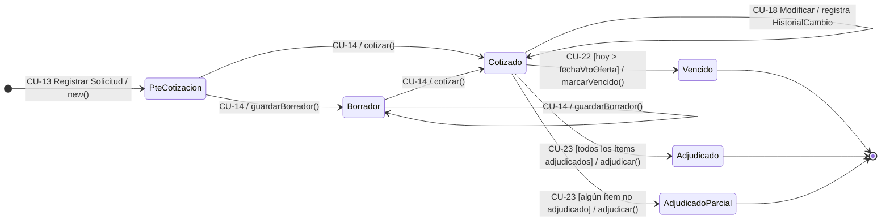
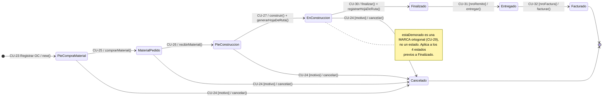

# 06 · Máquinas de estado

> Fuente: Modelo de Dominio V1.1 §2 y diagramas `Cotizacion V1.1.png` / `Orden De Trabajo.png`.
> **Regla de implementación:** toda transición que **no** figure en estas tablas debe **rechazarse** (p. ej. HTTP 409). Cada evento es un método explícito de la clase.
> Notación de transición: `evento() [guarda] / acción`.

---

## 1. Cotización (`Cotizacion.estado : EstadoCotizacion`)

### 1.1 Estados

| Estado | Significado | Operaciones admitidas |
|---|---|---|
| `PteCotizacion` | Hay una solicitud registrada y todavía no se empezó a cotizar. | Cargar, guardar borrador, emitir |
| `Borrador` | Cotización empezada y guardada a medias. **No corre el plazo de validez** (la fecha de vencimiento se calcula al emitir). Admite guardados sucesivos. | Cargar, modificar, guardar, emitir |
| `Cotizado` | Oferta emitida y vigente: el único estado en que se presenta al cliente. `🔁 D-04` Si se modifica, **sigue en `Cotizado`** y el cambio va al historial. | Modificar (CU-18), generar o enviar informe, adjudicar |
| `Vencido` | Venció el plazo sin adjudicación. Final: si el cliente sigue interesado se **recotiza** con una nueva cotización (RN05). | Solo consulta |
| `Adjudicado` | El cliente aprobó **todos** los ítems. Final. | Solo consulta |
| `AdjudicadoParcial` | El cliente aprobó **algunos** ítems (`ItemCotizacion.estaAdjudicado`). Final. | Solo consulta |

### 1.2 Transiciones

| # | Origen | Evento (método) | Guarda | Destino | Efectos | CU | RN |
|---|---|---|---|---|---|---|---|
| C1 | — | `new()` | — | `PteCotizacion` | Se crea junto con la solicitud | CU-13 | RN03 |
| C2 | `PteCotizacion` | `guardarBorrador()` | — | `Borrador` | Persiste lo cargado | CU-14 A18 | RN31 |
| C3 | `Borrador` | `guardarBorrador()` | — | `Borrador` | Autotransición | CU-14 A18 | RN31 |
| C4 | `PteCotizacion` / `Borrador` | `cotizar()` | Datos obligatorios completos y ≥ 1 ítem | `Cotizado` | Asigna `nroCotizacion`, calcula `fechaVtoOferta` y `precioFinal` | CU-14 | RN04, RN25, RN29 |
| C5 | `Cotizado` | modificación | — | `Cotizado` | Registra `HistorialCambio` y recalcula precios. `⚠️ SUPUESTO` No reinicia `fechaVtoOferta` | CU-18 | RN32, D-04 |
| C6 | `Cotizado` | `controlarFechaValidez()` | `hoy <= fechaVtoOferta` | `Cotizado` | Ninguno | CU-22 | RN29 |
| C7 | `Cotizado` | `marcarVencido()` | `hoy > fechaVtoOferta` | `Vencido` | — | CU-22 | RN29 |
| C8 | `Cotizado` | `adjudicar()` | Todos los ítems adjudicados | `Adjudicado` | Por ítem: `marcarAdjudicado()` + `crearOrdenDeTrabajo()` con `precioPactado` congelado (D-02). **Atómico** (RNF11) | CU-23 | RN33, RN34 |
| C9 | `Cotizado` | `adjudicar()` | Al menos un ítem adjudicado **y** al menos uno no | `AdjudicadoParcial` | Igual que C8, solo para los ítems adjudicados | CU-23 | RN33, RN34 |

### 1.3 Transiciones ilegales (deben rechazarse)

| Intento | Motivo |
|---|---|
| Adjudicar desde `PteCotizacion`, `Borrador` o `Vencido` | Solo se adjudica una oferta emitida y vigente (RN31) |
| Modificar en `Vencido`, `Adjudicado` o `AdjudicadoParcial` | Estados finales; precio congelado (RN31, RN34) |
| Adjudicar con cero ítems aprobados | No es adjudicación |
| Volver de `Cotizado` a `Borrador` | No hay transición; los cambios se hacen en `Cotizado` (D-04) |

---

## 2. Orden de Trabajo (`OrdenDeTrabajo.estado : EstadoOT`)

### 2.1 Estados

| Estado | Significado |
|---|---|
| `PteCompraMaterial` | Inicial. Trabajo autorizado; falta comprar el material. |
| `MaterialPedido` | Material solicitado: ya se registraron el proveedor, el precio y la cantidad reales. |
| `PteConstruccion` | Material disponible; el trabajo no empezó. |
| `EnConstruccion` | Fabricación o reparación en curso; hoja de ruta generada e imprimible. |
| `Finalizado` | Trabajo terminado; hoja de ruta registrada y desvíos calculados. Ya no se puede cancelar. |
| `Entregado` | Entregado al cliente con su nº de remito. |
| `Facturado` | Facturado con su nº de factura. **Fin del ciclo operativo.** |
| `Cancelado` | Salida excepcional, con motivo. Final. |

### 2.2 Transiciones

| # | Origen | Evento (método) | Guarda | Destino | Efectos | CU | RN |
|---|---|---|---|---|---|---|---|
| O1 | — | `new()` | Ítem adjudicado | `PteCompraMaterial` | Se crea con `precioPactado` congelado (D-02) | CU-23 | RN33, RN34 |
| O2 | `PteCompraMaterial` | `comprarMaterial()` | Proveedor, cantidad y precio informados | `MaterialPedido` | Crea `CompraDeMaterial` (`MaterialComprado`); un cambio de proveedor o material va a `historialPieza` | CU-25 | RN15, RN35, RN37 |
| O3 | `MaterialPedido` | `recibirMaterial()` | — | `PteConstruccion` | — | CU-26 | RN37 |
| O4 | `PteConstruccion` | `construir()` | — | `EnConstruccion` | `generarHojaDeRuta()` con los procesos planificados (modificables, con historial) | CU-27 | RN37, RN39 |
| O5 | `EnConstruccion` | modificar hoja de ruta | — | `EnConstruccion` | Cambia procesos (`procAgregados`); `HistorialCambio`; **el precio no cambia** | CU-28 | RN35 |
| O6 | `EnConstruccion` | `finalizar()` | Hoja de ruta completa (responsable y horas reales por proceso, material real) | `Finalizado` | `registrarHojaDeRuta()`: crea las `EjecucionProceso`; calcula desvíos. **Atómico** | CU-30 | RN39, RN40 |
| O7 | `Finalizado` | `entregar()` | `nroRemito` informado | `Entregado` | Crea `Remito` | CU-31 | RN41 |
| O8 | `Entregado` | `facturar()` | `nroFactura` informado | `Facturado` | Crea `Factura` | CU-32 | RN41 |
| O9 | `PteCompraMaterial`, `MaterialPedido`, `PteConstruccion`, `EnConstruccion` | `cancelar()` | `motivoCancelacion` informado | `Cancelado` | — | CU-24 | RN36 |

### 2.3 Marca ortogonal: demora

| Evento | Condición | Efecto | CU | RN |
|---|---|---|---|---|
| `verificarDemora()` (diario, Temporizador) | `estado ∈ {PteCompraMaterial, MaterialPedido, PteConstruccion, EnConstruccion}` ∧ `hoy > fechaEntregaPactada` | `marcarDemorado()` → `estaDemorado = true`. **No cambia el estado.** | CU-29 | RN38 |

`⚠️ SUPUESTO` La fecha de entrega pactada se obtiene con `ItemCotizacion.calcularFechaEntregaPactado()` (fecha de la OC + plazo de entrega del ítem).

### 2.4 Transiciones ilegales (deben rechazarse)

| Intento | Motivo |
|---|---|
| Saltear estados (p. ej. `PteCompraMaterial` → `Facturado`) | El ciclo es lineal (RN37) |
| Cancelar desde `Finalizado`, `Entregado` o `Facturado` | Una pieza construida no se cancela (RN36) |
| Entregar sin nº de remito / facturar sin nº de factura | Guardas O7 y O8 |
| Finalizar sin hoja de ruta completa | Guarda O6 |
| Cualquier transición desde `Facturado` o `Cancelado` | Estados finales |
| Modificar `precioPactado` en cualquier estado | Invariante RN34 |

---

## 3. Correspondencia evento ↔ caso de uso ↔ paso

| Clase | Evento / método | CU | Paso del CU que produce el cambio |
|---|---|---|---|
| Cotizacion | `new()` | CU-13 | Paso 15 |
| Cotizacion | `guardarBorrador()` | CU-14 | A18 |
| Cotizacion | `cotizar()` | CU-14 | Paso 43 |
| Cotizacion | `controlarFechaValidez()` / `marcarVencido()` | CU-22 | (no descripto) |
| Cotizacion | `adjudicar()` | CU-23 | (no descripto) |
| OrdenDeTrabajo | `new()` | CU-23 | (no descripto) |
| OrdenDeTrabajo | `comprarMaterial()` | CU-25 | (no descripto) |
| OrdenDeTrabajo | `recibirMaterial()` | CU-26 | (no descripto) |
| OrdenDeTrabajo | `construir()`, `generarHojaDeRuta()` | CU-27 | (no descripto) |
| OrdenDeTrabajo | `finalizar()`, `registrarHojaDeRuta()` | CU-30 | (no descripto) |
| OrdenDeTrabajo | `entregar()` | CU-31 | (no descripto) |
| OrdenDeTrabajo | `facturar()` | CU-32 | (no descripto) |
| OrdenDeTrabajo | `cancelar()` | CU-24 | (no descripto) |
| OrdenDeTrabajo | `verificarDemora()`, `marcarDemorado()` | CU-29 | (no descripto) |

---

## 4. Procesos programados (Temporizador)

| CU | Frecuencia | Sobre qué | Condición de disparo | Efecto | Si no corre un día |
|---|---|---|---|---|---|
| CU-22 | Diaria | Cotizaciones en `Cotizado` | `hoy > fechaVtoOferta` | → `Vencido` | `⚠️ SUPUESTO` La corrida siguiente procesa todas las vencidas (idempotente, condición por fecha y no por "ayer") |
| CU-29 | Diaria | OTs en los 4 estados previos a `Finalizado` | `hoy > fechaEntregaPactada` | `estaDemorado = true` | Igual: idempotente |

> **Nota de implementación:** la lógica de decisión (¿venció?, ¿está demorado?) va en una función pura que recibe la fecha actual (reloj inyectable), para poder testearla sin depender del reloj real.
