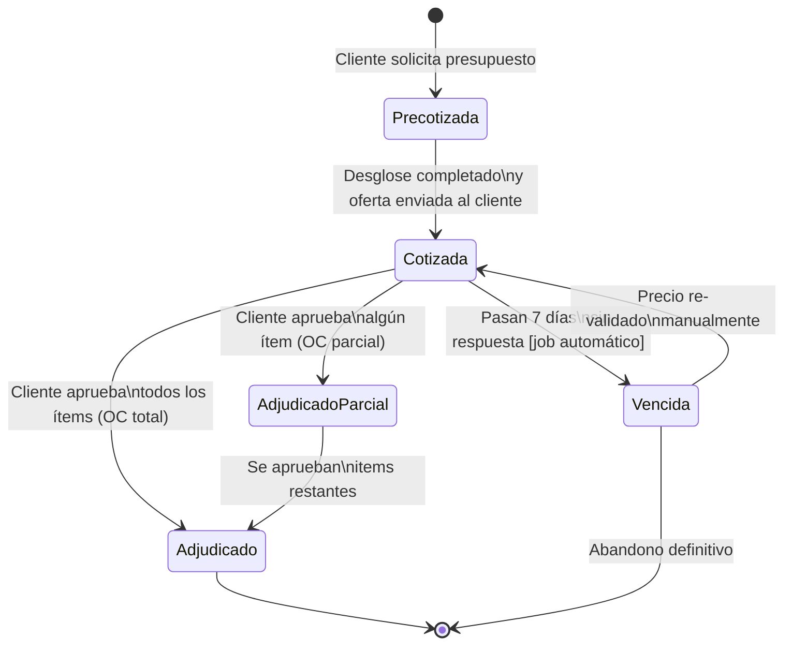
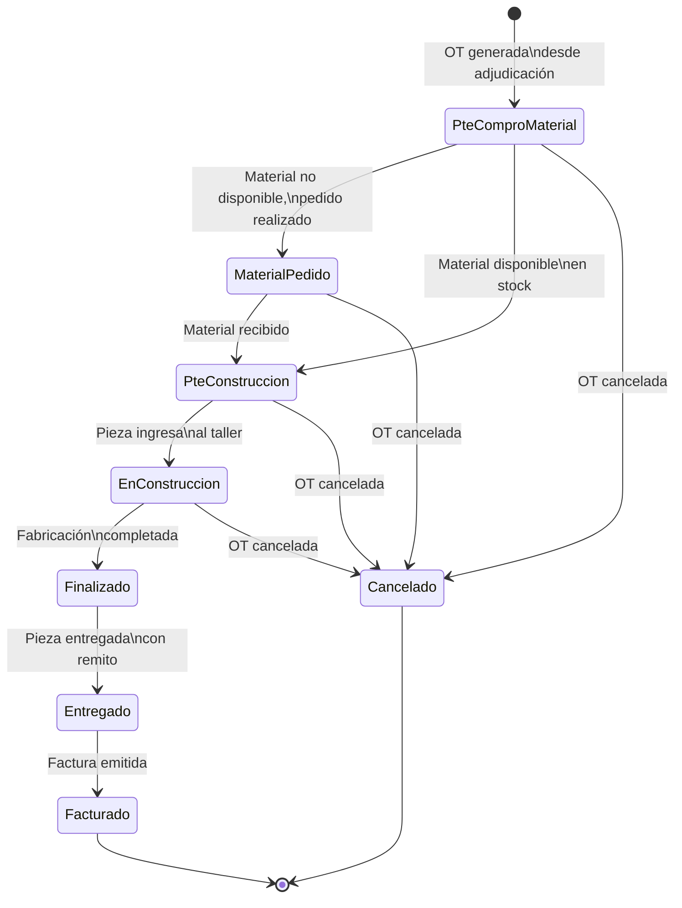

# Máquinas de Estado — Tornería Castro SRL

El sistema tiene dos máquinas de estado principales. Estos diagramas son la referencia canónica: cualquier transición de estado en el código debe tener su correspondencia aquí.

---

## 1. Cotización

### Estados

| Estado | Descripción |
|--------|-------------|
| `Precotizada` | La solicitud fue recibida pero aún no tiene precio definido. |
| `Cotizada` | El desglose de costos está completo y el informe fue enviado al cliente. El precio es modificable hasta la adjudicación. |
| `Vencida` | Pasaron más de 7 días desde la emisión sin respuesta del cliente. |
| `AdjudicadoParcial` | El cliente aprobó solo algunos ítems de la cotización. Se generan OTs para los ítems aprobados. |
| `Adjudicado` | El cliente aprobó todos los ítems. Se generan OTs para todos. El precio queda bloqueado. |

### Diagrama



### Transiciones detalladas

**Precotizada → Cotizada**
- Disparador: el equipo completa el desglose de costos y emite el informe al cliente.
- Efecto: se asigna el número correlativo de presupuesto (SEQUENCE de PostgreSQL).

**Cotizada → Vencida**
- Disparador: job automático que corre diariamente y verifica fechas de emisión.
- Efecto: la cotización queda como referencia histórica pero sin precio vigente.

**Cotizada → AdjudicadoParcial / Adjudicado**
- Disparador: recepción de Orden de Compra del cliente (formal o por WhatsApp).
- Efecto: se **bloquea el precio** de los ítems adjudicados (RN-01) y se **generan automáticamente las OTs** correspondientes (RN-03).

**Vencida → Cotizada**
- Disparador: re-validación manual del precio (común cuando el cliente retoma la negociación).
- Nota: puede requerir actualización por dólar (RN-05).

---

## 2. Orden de Trabajo (OT)

### Estados

| Estado | Descripción |
|--------|-------------|
| `PteComproMaterial` | Pendiente de comprobación de material. Se verifica si hay stock o hay que comprar. |
| `MaterialPedido` | El material necesario fue pedido al proveedor. |
| `PteConstruccion` | Material disponible, esperando turno para entrar a producción. |
| `EnConstruccion` | La pieza está activamente siendo fabricada en el taller. |
| `Finalizado` | La construcción está completa. Pieza lista para entrega. |
| `Entregado` | La pieza fue entregada al cliente (con remito). |
| `Facturado` | Se emitió la factura (estado final del sistema). |
| `Cancelado` | La OT fue cancelada. Estado terminal. |

### Diagrama



### Transiciones detalladas

**[*] → PteComproMaterial**
- Disparador: adjudicación de un ítem de cotización.
- Efecto: se crea la OT con todos los datos del ítem (pieza, cantidad, procesos planificados, precio bloqueado).

**PteComproMaterial → MaterialPedido / PteConstruccion**
- Disparador: verificación de stock por parte de administración o jefe de taller.
- Bifurcación: si el material existe, se salta directamente a `PteConstruccion`.

**EnConstruccion** (estado activo)
- Durante este estado, el Jefe de Taller puede registrar los procesos ejecutados y los tiempos reales.
- Estos datos alimentan la trazabilidad de rentabilidad (cotizado vs. real).

**→ Cancelado**
- Estado terminal alcanzable desde cualquier estado anterior a `Finalizado`.
- Caso muy poco frecuente según el cliente.

---

## Relación entre ambas máquinas

```
Cotización [Adjudicado / AdjudicadoParcial]
    │
    │  genera 1 OT por ítem adjudicado
    ▼
OrdenDeTrabajo [PteComproMaterial → ... → Facturado]
```

Una Cotización puede generar múltiples OTs. Cada OT es independiente y puede estar en distintos estados simultáneamente.
