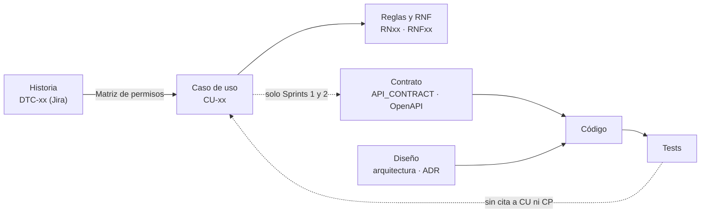

# Análisis de la documentación para desarrollo guiado por especificaciones (backend)

Relevamiento del 22 de octubre de 2026, rama `feature/back-process-types`.

**Pregunta:** ¿alcanza la documentación para programar el backend a partir de las especificaciones, sin tener que adivinar?

**Criterio.** En desarrollo guiado por especificaciones (*Spec-Driven Development*), una historia se programa sin adivinar cuando existe una cadena completa de cinco eslabones:

1. **Requisito.**
2. **Criterios verificables**: escenarios con datos y resultado esperado.
3. **Contrato**: endpoint, campos, códigos y mensajes.
4. **Diseño**: dónde va el código y con qué reglas.
5. **Tests trazables** hasta el requisito.

Cuando falta un eslabón, quien programa lo inventa, y lo inventado no se puede revisar contra nada.

Este documento no repite lo que ya está registrado: remite a las [inconsistencias documentales](inconsistencias-documentales.md) (DOC-xx), a los [pendientes actuales](pendientes-actuales.md) y al [backlog de ingeniería](engineering-backlog.md).

**Escala:**

| Estado | Significado |
| --- | --- |
| **Listo** | Se puede programar desde el documento |
| **Parcial** | Sirve, pero hay que completarlo o confirmarlo |
| **Falta** | No existe |
| **Bloquea** | Sin ese documento, el Sprint 3 (cotizaciones) no se puede especificar |

---

## 1. Cadena de trazabilidad actual

La cadena se corta en cuatro lugares:

1. **Las historias y sus escenarios viven solo en Jira.**
   - En el repositorio quedan los identificadores `DTC-xx`: la [Matriz de permisos](../dominio/Matriz%20de%20permisos.md) los vincula con un CU, y el [contrato](../api-contract/API_CONTRACT_SPRINT_2.md) los cita como "CU-05, escenario 3".
   - El texto de cada escenario no está en el repositorio, así que no se puede revisar un test contra él.
2. **59 de los 61 casos de uso son una sola línea.**
   - Solo CU-13 y CU-14 tienen precondición, secuencia, alternativas y resultado ([casos de uso](../dominio/04-actores-y-casos-de-uso.md)).
   - Ningún caso de uso trae los mensajes de error.
3. **El contrato cubre los Sprints 1 y 2.** Solicitudes, cotizaciones, ítems, archivos, órdenes de trabajo y reportes no tienen contrato.
4. **Ningún test cita su caso de uso.**
   - [`test-cases-structure.md`](../testing/test-cases-structure.md) define los identificadores `CP-NN` y etiquetas como `[CU-23][INV-1]`, pero ningún test las usa.
   - El catálogo `.docx` de casos de prueba y `estrategia-qa.md` no existen ([DOC-06](inconsistencias-documentales.md#doc-06--organización-y-ejecución-de-las-pruebas), [DOC-09](inconsistencias-documentales.md#doc-09--archivos-citados-que-no-existen)).

---

## 2. Inventario por área

| Área | Documentos | Estado | Observación |
| --- | --- | --- | --- |
| Reglas de negocio | [02](../dominio/02-reglas-de-negocio.md) | **Listo** | 44 reglas con tipo, fórmula y trazabilidad. Sirven para derivar invariantes y tests unitarios. No traen mensajes de error |
| Requisitos | [03](../dominio/03-requerimientos.md) | **Listo** | RF con prioridad y RNF con una línea de "Verificación" medible |
| Casos de uso | [04](../dominio/04-actores-y-casos-de-uso.md) | **Parcial** | Catálogo completo; solo CU-13 y CU-14 descriptos |
| Modelo de dominio | [05](../dominio/05-modelo-de-dominio.md) | **Parcial** | Clases y multiplicidades en español, sin la correspondencia con los nombres del código. Falta la entidad que registra los envíos del informe (§4) |
| Máquinas de estado | [06](../dominio/06-maquinas-de-estado.md) | **Listo** | Transiciones con guarda y efecto, y tablas de transiciones ilegales. Es el documento más listo para escribir tests |
| Permisos | [07](../dominio/07-matriz-rbac.md), [Matriz de permisos](../dominio/Matriz%20de%20permisos.md) | **Listo** | Matriz CU × rol, campos ocultos al taller (JT) y criterio de verificación (§4) |
| Funcionalidades | [funcionalidades/](../funcionalidades/) | **Parcial** | Síntesis narrativas sin criterios de aceptación. `reportes.md` lo aclara explícitamente |
| Contrato del Sprint 2 | [API_CONTRACT_SPRINT_2](../api-contract/API_CONTRACT_SPRINT_2.md) | **Listo** | Campos, mensajes exactos, ejemplos por código HTTP, catálogo de `code` y 52 decisiones. **Ninguno de sus endpoints está implementado** |
| OpenAPI | [openapi.yaml](../openapi/openapi.yaml) | **Listo** | 39 operaciones, `Error` estándar con `code` y `x-roles`. Inconsistencias internas en §5 |
| Arquitectura del backend | [backend.md](../arquitectura/backend.md), [ADR-013](../decisiones/013-arquitectura-interna-backend.md), [ADR-014](../decisiones/014-subsistemas.md) | **Parcial** | Creados en este relevamiento. Quedan 8 decisiones abiertas (DA-01 a DA-08) |
| Base de datos | [DER](../database/der-sprint-1-2.md), [cambios del Sprint 2](../database/cambios-bdd-sprint2.md) | **Listo** | El DER coincide con `schema.prisma`. Los encabezados quedaron viejos (§4) |
| Testing | [code-structure](../testing/code-structure.md), [test-cases-structure](../testing/test-cases-structure.md), [backend/test/README](../../backend/test/README.md) | **Parcial** | Describen una organización que el código no sigue ([DOC-06](inconsistencias-documentales.md#doc-06--organización-y-ejecución-de-las-pruebas)) |
| Plantillas | [plantillas/](../plantillas/) | **Parcial** | Son de redacción. Ninguna sirve para escribir una historia con criterios de aceptación, un endpoint o un caso de prueba |
| Contexto del agente | [`.claude/CLAUDE.md`](../../.claude/CLAUDE.md), [regla del flujo HU](../../.claude/rules/flujo-hu-backend.md) | **Parcial** | Actualizados en este relevamiento. Quedan sin corregir los 7 roles y la tabla de ADR hasta el 009 |

---

## 3. Documentos que faltan

### P1: bloquean especificar el Sprint 3

| Documento | Ubicación propuesta | Contenido mínimo | Estado |
| --- | --- | --- | --- |
| Historias con criterios de aceptación | `docs/historias/<area>/DTC-xx.md`, o un export de Jira versionado | Historia, CU y RN que implementa, escenarios **Dado / Cuando / Entonces** con datos concretos, endpoint y `code` esperado de cada escenario | **Bloquea** |
| Plantilla de historia de usuario | `docs/plantillas/historia-de-usuario.md` | Las secciones de arriba y la regla de que cada escenario tiene un resultado observable | **Falta** |
| Descripción completa de CU-15 a CU-23 | [04-actores-y-casos-de-uso.md](../dominio/04-actores-y-casos-de-uso.md) | Mismo nivel que CU-13 y CU-14: precondición, secuencia, alternativas con paso de retorno, resultado y cambios de estado | **Bloquea** |
| Contrato de solicitudes, cotizaciones, ítems, archivos y envío del informe | `docs/api-contract/API_CONTRACT_SPRINT_3.md` y `docs/openapi/` | Igual que el del Sprint 2, más la variante sin importes para JT ([07 §2.2](../dominio/07-matriz-rbac.md)) | **Bloquea** |
| Guía del modelo de errores | Sección del contrato o `docs/conceptos-transversales/errores.md` | Familias de error → status → `code` del catálogo, mensajes en español, y cómo se agrega un `code` nuevo. El diseño está en [backend.md](../arquitectura/backend.md#modelo-de-errores) | **Falta** |
| Glosario español → inglés | Sección nueva en [glosario.md](../glosario.md) | Término del negocio → clase, tabla y ruta. Por ejemplo: encargado → `Manager` (código) / `Customer` (Prisma) / `manager_customer` / `/managers`. El contrato ya lo pedía | **Falta** |
| Definition of Ready y Definition of Done | `docs/CONTRIBUTING.MD` | **Ready:** la historia tiene escenarios, CU detallado y contrato. **Done:** tests verdes contra el contrato, lint, OpenAPI y migración. Hoy lo más parecido es el checklist de `.github/PULL_REQUEST_TEMPLATE.md` | **Falta** |
| Catálogo único de decisiones | `docs/dominio/` o `docs/seguimiento/` | Prefijos distintos por origen. Hoy `D-02` significa tres cosas: en el dominio, en el contrato y en pendientes ([DOC-08](inconsistencias-documentales.md#doc-08--decisiones-d-xx)) | **Falta** |

### P2: necesarios antes de implementar autenticación y cotizaciones

| Documento | Contenido mínimo |
| --- | --- |
| Guía de seguridad y control de acceso (`conceptos-transversales/`) | Hoy está repartida en RNF08–RNF10, ADR-005 (desactualizado, [DOC-05](inconsistencias-documentales.md#doc-05--roles-y-accesos-de-adr-005-y-de-la-arquitectura)), el contrato §4 y los cambios de base §7. Debe consolidar sesión, refresco, bloqueo, guards, ocultamiento de campos para JT y qué se registra. También resuelve DA-04 de `backend.md` |
| Guía de transacciones y concurrencia | Numeración correlativa (RN04, RN06), transiciones atómicas (C8, O6), escrituras condicionales y el uso de `TransactionManagerPort`. Hoy solo existe para el Sprint 2 ([cambios de base §7](../database/cambios-bdd-sprint2.md)) |
| `docs/testing/estrategia-qa.md` | Los invariantes INV-1 a INV-5 que citan las guías de testing: precio inmutable, correlativo, el taller no ve importes, máquinas de estado cerradas y trazabilidad |
| Convenciones generales de la API | Baja con `DELETE`, nombres de filtros, activos por defecto, orden, versionado, límite de página. Resuelve DA-03 |
| Especificación de procesos programados | CU-22 (vencimiento de cotización) y CU-29 (demora de OT): horario, zona horaria, idempotencia y qué se registra |
| Auditoría y registro de actividad | Alcance de `HistorialCambio` (RNF10) más allá de los precios de tipos de proceso, `created_by_user_id`, retención de sesiones (BD-04, BD-05) y formato de log (RNF13, backlog §7) |

### P3: mejoran la trazabilidad

- **README por módulo de test** con la matriz escenario → test, como pide [test-cases-structure](../testing/test-cases-structure.md). No existe ninguno.
- **Plantilla de especificación de endpoint**, para que los contratos de cada sprint tengan la misma forma.
- **Renumerar el "ADR-011 — Despliegue continuo"** que pide el [backlog §3](engineering-backlog.md#3-despliegue-continuo-rama-propia-adr-propio). Choca con el ADR-011 existente; el próximo número libre es el 015.

---

## 4. Documentos incompletos o desactualizados

| Documento | Qué falta o quedó viejo |
| --- | --- |
| [arquitectura/overview.md](../arquitectura/overview.md) | La tabla de módulos (`identity`, `customers`, `employees`, `supplier`, `technicalCatalog`) no coincide con el [ADR-014](../decisiones/014-subsistemas.md). Además: rol `A` ([DOC-05](inconsistencias-documentales.md#doc-05--roles-y-accesos-de-adr-005-y-de-la-arquitectura)), todos los ADR marcados como aprobados ([DOC-01](inconsistencias-documentales.md#doc-01--estados-de-los-adr)) y enlace roto a `uso-ORM-DB/Migrations.md` |
| [docs/README.md](../README.md) | Etiquetas en inglés (`architecture/`, `decisions/`, `domain/`). Presenta los cambios de base del Sprint 2 como "propuesta, sin aplicar" |
| `SETUP.md`, `vision-general.md`, `backend/README.md`, `overview.md` | Enlace roto a `uso-ORM-DB/Migrations.md`. La ruta real es `database/Prisma/Migrations.md` |
| [database/Prisma/Migrations.md](../database/Prisma/Migrations.md) | Enlaces a los ADR con un nivel de menos (`../decisiones/` en lugar de `../../decisiones/`) |
| [cambios-bdd-sprint2.md](../database/cambios-bdd-sprint2.md), [der-sprint-1-2.md](../database/der-sprint-1-2.md) | El encabezado dice "migraciones pendientes", pero `20261021181949_schema_sprint2` y `20261021182201_sprint2_manual_constraints` ya existen |
| [dominio/00-indice](../dominio/00-indice-y-convenciones.md), [05](../dominio/05-modelo-de-dominio.md) | Remiten a `08-erd.md`, que no existe. El DER real es `database/der-sprint-1-2.md` |
| [testing/code-structure.md](../testing/code-structure.md), [test-cases-structure.md](../testing/test-cases-structure.md) | Dicen Zod (el backend usa class-validator). Usan módulos en español y ejemplos que no coinciden con el dominio: "DNI" del encargado, CU-18 "Aplicar descuento", estados `Pendiente → Cotizada`. Atribuyen la CI al ADR-009 en lugar del 010 |
| [backend/test/README.md](../../backend/test/README.md) | Dice que hay "un solo nivel", pero existen `test:api` y `modules/suppliers/{api,int}`. Faltan las etiquetas de CU. Hay factories duplicadas, y `shared/auth/login-as.ts` está comentado |
| [funcionalidades/catalogos-tecnicos.md](../funcionalidades/catalogos-tecnicos.md) | El título empieza con `ad#` |
| [rubros-desvios-contrato.md](../rubros-desvios-contrato.md) | Es temporal ("borrar este archivo") y sigue vigente: el 409 de rubros todavía no envía `code` ni `details` |
| ADR-001 a ADR-012 | Los estados siguen sin aprobar ([DOC-01](inconsistencias-documentales.md#doc-01--estados-de-los-adr)). ADR-005 describe una tabla de tokens revocados; lo aplicado es sesión en el servidor con rotación del refresco |
| [.claude/CLAUDE.md](../../.claude/CLAUDE.md) | Quedan 7 roles con `A` y la tabla de ADR hasta el 009 |

---

## 5. Inconsistencias que bloquean el desarrollo guiado por especificaciones

Ninguna de estas está en [inconsistencias documentales](inconsistencias-documentales.md). Se proponen como **DOC-13 a DOC-18** para que el equipo las registre ahí.

| Propuesta | Inconsistencia | Por qué bloquea |
| --- | --- | --- |
| DOC-13 | **Tres fuentes de verdad.** `CONTRIBUTING.MD` dice que manda el OpenAPI; `openapi.yaml` y el contrato dicen que manda el contrato en `.md`; el encabezado del contrato declara como fuente de verdad el prototipo, y ante diferencias con el dominio el contrato sigue al prototipo | Ante una diferencia no se sabe contra qué escribir el test |
| DOC-14 | **`D-xx` repetidos.** El dominio (D-01 a D-05), el contrato (D-01 a D-52) y los pendientes (D-02, D-03) usan los mismos identificadores con otro significado. `cambios-bdd-sprint2.md` cita los del contrato | Una referencia `D-02` es ambigua. DOC-08 registra el problema solo para el dominio |
| DOC-15 | **Momento del número y del vencimiento de la cotización.** CU-14 paso 6 los asigna al confirmar los datos generales. La transición C4 los asigna en `cotizar()` y dice que en `Borrador` no corre el plazo | Define el invariante central de `Quote` y la regla RN04 |
| DOC-16 | **Límite de página.** `openapi.yaml` dice de 1 a 1000; `LimitParam.yaml`, el contrato (D-03) y `pagination.ts` dicen 100 | Contrato contradictorio para todos los listados |
| DOC-17 | **D-35 del contrato cita RNF12 (dos decimales).** Es RNF11; RNF12 es disponibilidad | Trazabilidad incorrecta en un requisito de cálculo |
| DOC-18 | **Contrato del Sprint 2 sin implementación.** Sesión, usuarios, empleados, tipos de proceso, tipo de cambio y materiales están contratados, con modelos Prisma y migraciones, pero sin código. Además, el contrato exige sesión en todos los endpoints del Sprint 1 (D-40), y hoy ninguno la pide | El frontend del Sprint 2 se construye contra mocks, y el cambio que rompe al Sprint 1 todavía no tiene fecha |

---

## 6. Orden de trabajo recomendado

Antes de programar el Sprint 3:

1. **Decidir la fuente de verdad** (DOC-13) y **los prefijos de decisiones** (DOC-14). Son baratos y destraban todo lo demás.
2. **Escribir la plantilla de historia y la Definition of Ready.** Desde ese momento, una historia sin escenarios no entra al sprint.
3. **Crear el glosario español → inglés** con lo que ya existe: rubros, fábricas, encargados, proveedores, usuarios, empleados, tipos de proceso y materiales. Sumar las clases de cotización antes de empezarlas.
4. **Implementar el Sprint 2 contra su contrato.** El contrato está listo, y la sesión (D-40) cambia todos los endpoints existentes.
5. **Documentar el modelo de errores** (guía de §3) y **la guía de seguridad**, que resuelven DA-04 de `backend.md`.
6. **Para el Sprint 3:**
   - detallar CU-15 a CU-23;
   - resolver DOC-15;
   - decidir DA-01 y DA-02 (frontera entre cotizaciones y órdenes de trabajo);
   - escribir el contrato del Sprint 3.

   Recién entonces programar.
